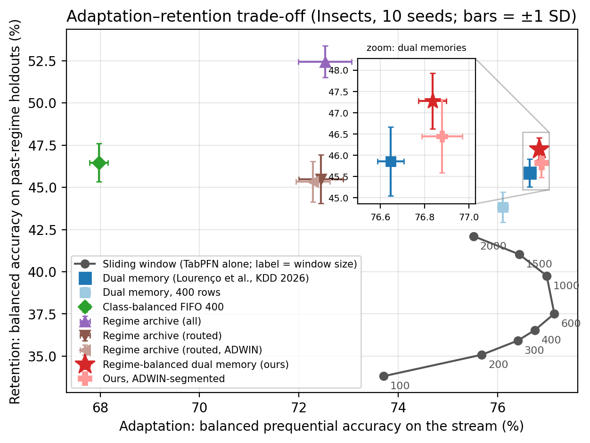
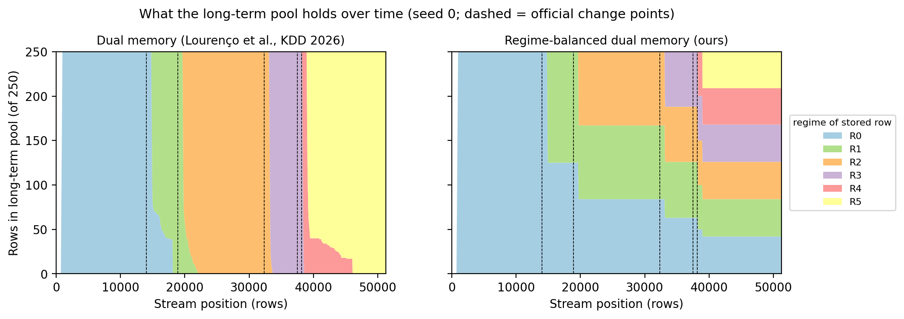
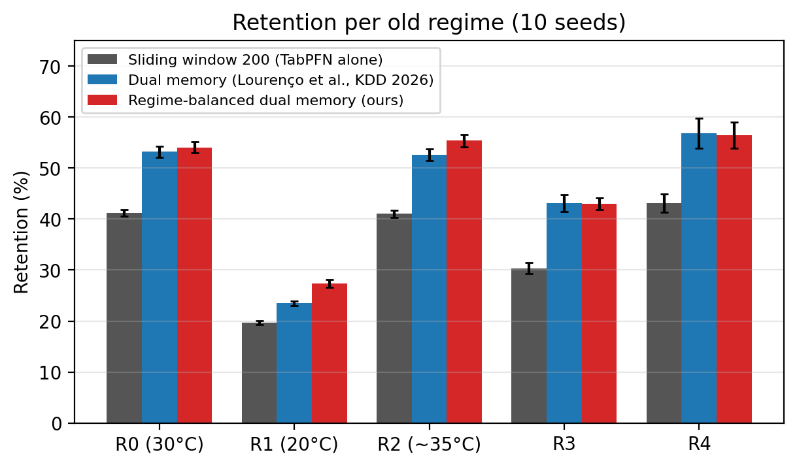
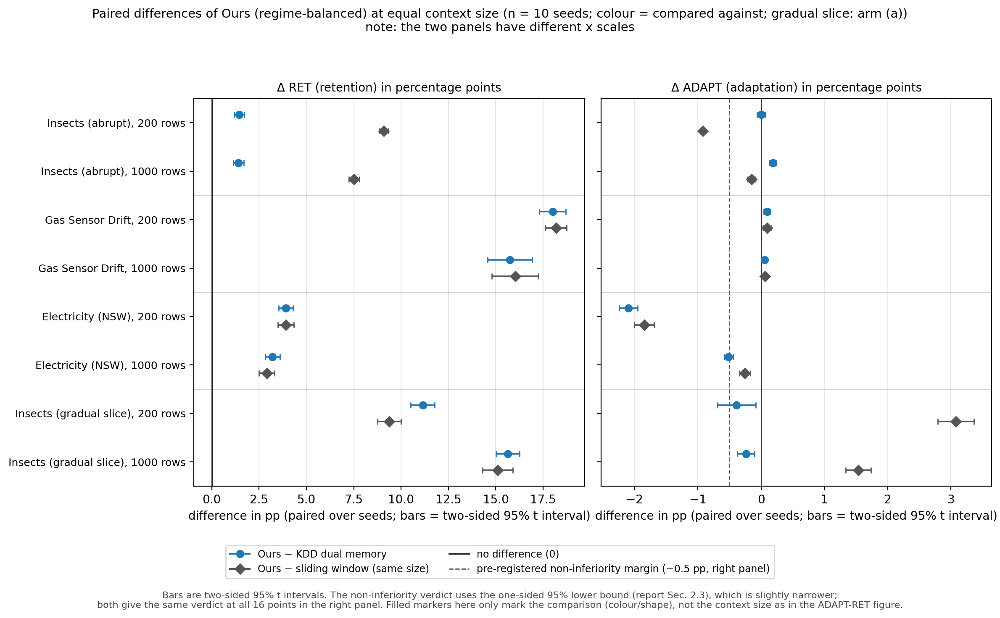

# Balancing Adaptation and Forgetting in Tabular Foundation Models under Concept Drift

*A study of context memory for a frozen TabPFN on concept-drift data streams*

Master's thesis project, KTH Royal Institute of Technology · Wenbo Xia · [中文版](#中文版)

**Thesis draft (13 November 2026):** [Wenbo_Xia_MSc_Thesis_Draft.pdf](thesis/Wenbo_Xia_MSc_Thesis_Draft.pdf). It includes rounds 5 and 6 below.

---

## Summary

A frozen tabular foundation model such as TabPFN never updates its weights. It "learns" a data stream only through the rows placed in its context, so the context is its only memory of the stream, and only a bounded number of rows fit. Which rows should it keep? On four public concept-drift streams (Insects abrupt and gradual, Gas Sensor Array Drift, Electricity), in a study pre-registered with documented amendments, this project measures **adaptation** (accuracy on the incoming rows, each predicted before its label is revealed) and **retention** (accuracy of the current context on held-out rows of earlier regimes). It compares a sliding window with four dual memories, which keep a short-term FIFO of recent rows plus a long-term part and differ only in which long-term row they evict: the class-balanced dual memory (Lourenço et al., KDD 2026), the CBRS dual memory (class-balancing reservoir sampling, Chrysakis & Moens, 2020), and two designs of this project, the regime-balanced dual memory (the first version, rounds 2–4) and the regime-balanced CBRS dual memory (round 6).

- **Forgetting is large, and stream accuracy hides it.** With only the 200 most recent rows, accuracy on the earlier regimes of Insects (abrupt), scored by regime, is 35.08 %, against 75.68 % on the stream (chance: 16.7 %). Within each stream and context size, the four memories of the main comparison (the first four rows of each block of the table below) differ by at most 4.5 pp in adaptation but by up to 13.3 pp in retention on fixed segments (23.7 pp when retention is scored by regime). The forgetting is not an artefact of scoring by regime: it also shows on fixed segments, where the CBRS dual memory, which uses no regime information, retains 3.4 to 11.2 pp more than the class-balanced dual memory on Gas, Electricity and Insects (gradual), in every seed.
- **Memories forget because they evict the oldest row of a group, at two levels.** The class-balanced dual memory evicts the oldest row of its most common class. Where the classes arrive mixed (Gas, Electricity), it keeps almost only the newest rows: 94.7–97.5 % of its rows are those a sliding window of the same size would hold, and its retention scored by regime differs from that window's by only −0.30 to +0.28 pp. We call this *recency collapse*; in this strict sense it occurs on these two streams only. The first version gives every regime a roughly equal share but evicts the oldest row within a regime, so it keeps only the last stretch of each regime (mean position of its rows within their regime 0.78–1.00, where 0 is the start and 1 the end; on Electricity the last one or two days of each season).
- **Keeping old rows matters most; how they are shared among regimes matters less.** On fixed segments, the three memories that keep old rows (CBRS, regime-balanced CBRS and the first version) retain 2.2 to 13.4 pp more than the class-balanced dual memory on Gas, Electricity and Insects (gradual), in 10/10 seeds, but only −1.1 to +1.3 pp, about zero, on Insects (abrupt). Between the two memories that sample old rows uniformly, the regime-balanced CBRS dual memory, which gives every regime an equal share, retains more than the CBRS dual memory, which samples each class over the whole stream, on Gas, whose regimes differ much in length (+1.84 / +0.87 pp at 200 / 1 000 rows), as much on Electricity (+0.37 / −0.30), and less on Insects (abrupt) (−1.24 / −0.96) and Insects (gradual) (−1.74 / −0.23). Which of the two suits which stream is a hypothesis for further streams.
- **Keeping old rows costs adaptation where the target depends on the recent past.** On Electricity at 200 rows, adaptation falls against the class-balanced dual memory by 4.45 pp (CBRS), 3.39 pp (regime-balanced CBRS) and 2.10 pp (first version); on Gas and Insects (abrupt) it changes by at most 0.25 pp.
- **Without given regime boundaries** (regimes closed at ADWIN alarms), the first version keeps most of its gain over the class-balanced dual memory on Gas (+7.58 / +9.02 pp) and Insects (gradual) (+2.24 / +2.83), but not on Electricity (−2.34 / +0.69), where the alarms do not track the season changes: the effect depends on how well the changes are detected.

Retention should therefore be reported next to stream accuracy.

| Memory (TabPFN frozen) | Insects (abrupt) | Gas | Electricity | Insects (gradual) |
|---|---|---|---|---|
| **Retention on fixed 2 000-row segments (RET_seg, %)** | | | | |
| Sliding window | 40.68 / 47.26 | 84.08 / 86.50 | 66.53 / 68.39 | 47.59 / 53.11 |
| Class-balanced dual memory (Lourenço et al., KDD 2026) | 49.78 / 53.89 | 84.33 / 87.02 | 66.53 / 68.14 | 50.16 / 55.90 |
| CBRS dual memory (Chrysakis & Moens, 2020) | 49.88 / 55.16 | 95.55 / 98.05 | 69.91 / 73.10 | 55.08 / 61.37 |
| Regime-balanced CBRS dual memory (round 6) | 48.64 / 54.20 | 97.39 / 98.93 | 70.28 / 72.80 | 53.35 / 61.14 |
| *Regime-balanced dual memory (first version, rounds 2–4)* | *49.58 / 54.14* | *97.72 / 98.73* | *69.85 / 70.64* | *52.35 / 60.01* |
| **Adaptation (ADAPT, %)** | | | | |
| Sliding window | 75.68 / 76.99 | 98.54 / 99.02 | 82.33 / 77.43 | 68.80 / 74.48 |
| Class-balanced dual memory | 74.76 / 76.65 | 98.55 / 99.03 | 82.58 / 77.68 | 72.27 / 76.25 |
| CBRS dual memory | 74.67 / 76.74 | 98.73 / 99.11 | 78.13 / 77.25 | 70.93 / 75.06 |
| Regime-balanced CBRS dual memory | 74.77 / 76.90 | 98.70 / 99.08 | 79.19 / 77.80 | 71.32 / 75.19 |
| *Regime-balanced dual memory (first version)* | *74.76 / 76.84* | *98.64 / 99.09* | *80.48 / 77.17* | *71.88 / 76.01* |

*Balanced accuracy, mean over 10 seeds, at 200 / 1 000 context rows. RET_seg scores the held-out rows of fixed 2 000-row segments, whose boundaries no memory uses; the official retention (RET), averaged over the earlier regimes, is in the reports below and in [results/round5_per_seed.csv](results/round5_per_seed.csv). The first four rows of each block are the memories of the main comparison; in italics the first regime-balanced design, the method of rounds 2–4. The dual memories keep a short-term FIFO of 75 % of the budget and a long-term part of 25 %. Code names: `sw*`, `dual*`, `dual*_cbrs`, `dual*_rbr`, `dual*_rb` (`*` = 200 or 1000). The reports and figures of rounds 2–4 call the class-balanced dual memory "KDD (dual memory)" and the first regime-balanced design "ours".*

---

## The study in two steps

File names use the project's internal numbering: *round 1* = Step 1, *round 2* (`phase56_*`) = Step 2, *round 3* = Step 2 on further datasets, *round 4* = the short/long split analysis, *rounds 5 and 6* = the analyses added after the first draft.

### Step 1 · Preliminary study: a three-level system with a drift detector (negative result)

The first design added two layers around the frozen TabPFN: a learnable gated adapter and a non-parametric (KNN) residual corrector. A drift detector (river ADWIN) triggered an action after each alarm: switch adapter, reset the context, or clear the corrector's buffer.

It was tested on short Insects segments around three change points (binary task, two drift segments plus one without drift, one seed):

- **Detector.** Most of its alarms followed long single-class runs of labels rather than drifts. Depending on its input signal, it alarmed 22–23 rows *before* one change point (inside the single-class run that ends there) and 25–75 rows after another (at the end of a 538-row single-class run); all inputs missed the third. It raised no alarm on the no-drift segment.
- **Actions.** No action gave a measurable gain over "no action". With an oracle trigger exactly at the true change point the difference was −3 to +4 errors; over all 21 cases with an alarm it was −6 to +5 errors, and the smallest p was 0.36.
- **Cost.** The extra layers themselves cost 23 and 26 errors (about 1–2 pp) on two of the three segments, including the one without drift.

The room for recovery after these drifts was small, so the question changed from *how to react to a drift* to *what the model still remembers*, which is Step 2.

| Script | Purpose |
|---|---|
| `scripts/run_phase4_a.py` | three-level system on one stream (detector, trigger and action flags) |
| `scripts/run_baselines.py` | TabPFN with a sliding-window or dual-memory context |
| `scripts/run_multiseed.py` | batch driver over configurations, segments and seeds |
| `scripts/reproduce_round1.sh` | all runs of Step 1, then `scripts/analyze_round1.py` prints the numbers above |
| `scripts/diag_contrast_signal.py` | offline comparison of detector inputs |
| `scripts/run_phase2.py`, `scripts/run_phase3.py` | earlier synthetic-data stages (thesis appendix, not part of the reported results) |

### Step 2 · Main experiment: context memory for adaptation vs. forgetting (positive result)

**Protocol.**

- The full Insects `abrupt_balanced` stream (Souza et al., 2020): 52 848 rows, 33 features, 6 classes and 5 official change points, hence 6 regimes.
- From every regime, a class-stratified held-out set is drawn across the whole regime and removed from the stream.
- Batch-incremental prequential evaluation, 50 rows per batch.
- Every 500 rows, the current memory is used to predict the held-out data of all regimes seen so far. This measures retention without ever changing the memory.
- Hypotheses, thresholds and tests were fixed in a [pre-registration](results/phase56_prereg.md) before the main runs. Formal verdicts use 10 seeds.

**The regime-balanced dual memory** (the first version; "ours" in the reports of rounds 2–4) keeps the structure of the class-balanced dual memory: a 750-row short-term FIFO plus a 250-row long-term pool, both always in the context. Only the long-term pool's eviction rule changes. It first finds the regime that holds the most rows, then the most frequent class within it, and drops that class's oldest row in that regime. Regimes come from the official change points or, in the `_adwin` variant, from ADWIN alarms on the model's own errors. With a single regime the rule is identical to the class-balanced dual memory.

**How the method was chosen.** The originally pre-registered method was a query-routed regime archive (`arch_routed`). It failed the pilot's go criterion: adaptation was −2.71 pp against a limit of −2 pp. Amendment 1, made after the pilot and before the main runs, replaced it with the regime-balanced dual memory and re-targeted the hypotheses. The pilot used seed 0, which is also one of the 10 main seeds. `arch_routed` is still reported against the original hypotheses: retention +10.41 pp, but adaptation −3.24 pp (fails H2), and −0.37 pp retention against the class-balanced dual memory (fails H3).

**Results of round 2 (Insects (abrupt), 16 context policies).**

| Context policy (TabPFN frozen in all rows) | Context rows | Adaptation (%) | Retention (%) |
|---|---|---|---|
| Sliding window (default baseline) | 200 | 75.68 | 35.08 |
| Sliding window, same budget | 1 000 | 76.99 | 39.76 |
| Class-balanced dual memory (our reimplementation: 75 % short-term) | 1 000 | 76.65 | 45.86 |
| **Regime-balanced dual memory (first version)** | 1 000 | **76.84** | **47.27** |
| Same, with regimes found by ADWIN instead of the official change points | 1 000 | 76.88 | 46.45 |

*Insects `abrupt_balanced` stream, 6 classes, balanced accuracy (chance = 16.7 %), mean over 10 seeds. Adaptation = accuracy on the stream; retention = official RET, the accuracy on held-out data of earlier regimes.*

- Retention is **12.19 pp higher** than the 200-row window and 7.51 pp higher than a 1 000-row window, in 10/10 seeds. Adaptation is 1.16 pp higher than the 200-row window, but 0.15 pp lower than the 1 000-row window, so the adaptation gain comes from the larger context, not from the method.
- Most of the retention gain, 10.78 pp over the 200-row window, is already achieved by the class-balanced dual memory. Balancing its long-term pool by regime adds **1.42 pp** (10/10 seeds, significant). That is below the pre-registered 2 pp threshold, so the hypothesis is reported as **not met**. On fixed 2 000-row segments (round 5) the difference is only +0.25 pp, so this gain is not confirmed there.
- Why it helps (memory replay, seed 0): the long-term pool of the class-balanced memory is gradually taken over by the newest regime, and at the end of the stream all 250 rows come from the last one. The regime-balanced memory keeps about 42 rows of every regime. The gain is concentrated on two old regimes (R1 +3.95 pp, R2 +2.76 pp); there is none on R3 and R4. The class-balanced memory also drops R3 from its pool quickly, so why R3 does not gain is not yet understood. (The replays of round 5 add that within each regime only the newest rows survive; see below.)
- What it costs: right after 3 of the 5 drifts, the 1 000-row memory recovers more slowly than the 200-row window (it is never slower than the class-balanced dual memory there, and faster after two of them). While regimes R1, R2 and R5 are current, the method is 1.8–3.7 pp below the class-balanced dual memory on that regime's own held-out data.



*Grey line: sliding windows of 100–2 000 rows. Bars: ±1 SD over 10 seeds. The inset zooms in on the three dual memories. The figure labels the class-balanced dual memory "Dual memory (Lourenço et al., KDD 2026)" and the regime-balanced dual memory "ours".*

**Pre-registered hypotheses, as amended.** H1–H3 are primary: one-sided paired tests over 10 seeds, Holm-corrected, sign in ≥ 9/10 seeds. H4–H8 are secondary and descriptive.

| | Type | Hypothesis | Result | Verdict |
|---|---|---|---|---|
| H1 | primary | Retention ≥ 5 pp above the 200-row window | +12.19 pp | met |
| H2 | primary | Adaptation at most 0.5 pp below the 200-row window (also with single-class runs masked) | +1.16 pp (masked +1.75) | met |
| H3 | primary | Retention ≥ 2 pp above the class-balanced dual memory | +1.42 pp | **not met** |
| H4 | secondary | Accuracy in the 500 rows after a drift ≥ 5 pp above the 200-row window after 19 500 and 38 682; within ±2 pp after 14 352 and 39 510 | −6.7, −8.1; −4.2, +0.7 pp | **not met** |
| H5 | secondary | No sliding-window size is at least as good on both axes | none is | met |
| H6 | secondary | Retention ≥ 2 pp above a class-balanced FIFO of 400 rows | +0.81 pp (that FIFO adapts 8.87 pp worse) | **not met** |
| H7 | secondary | Adaptation at most 0.5 pp below the class-balanced dual memory | +0.19 pp | met |
| H8 | secondary | The ADWIN variant keeps ≥ half of the H1 gain and passes H2 | +11.37 pp; passes | met |



*Rows of each regime in the 250-row long-term pool along the stream (seed 0). Left: class-balanced dual memory. Right: regime-balanced dual memory (first version).*



*Retention on each earlier regime (mean ± SD over 10 seeds).*

**Limitations.**

- One dataset and one stream order (round 3 below adds three streams). The 10 seeds vary only the held-out sample and TabPFN's randomness, so the small p-values do not speak to other streams.
- The method was chosen after the pilot (see above).
- The dual memories use 1 000 context rows; the default baseline uses 200. The 1 000-row sliding window is the equal-budget reference.
- There is no non-TabPFN stream learner (e.g. ARF, SRP) as a baseline, and the 75 / 25 short/long split was not varied (round 4 below varies it at 200 rows).
- The ADWIN variant still uses the official change points to align batches and to define the held-out sets.

The full report covers all 16 methods, every table, the mechanism, the costs, the ADWIN analysis, a batch-size check and the limitations: **[results/phase56_round2.md](results/phase56_round2.md)** (in Chinese; figures in English). Per-seed numbers are in [results/round2_per_seed.csv](results/round2_per_seed.csv).

| Script | Purpose |
|---|---|
| `scripts/run_round2.py` | one method on the full stream for one seed |
| `scripts/run_round2_multiseed.py` | methods × seeds; skips runs that already exist |
| `scripts/run_round2_transfer.py` | 6 × 6 regime transfer matrix |
| `scripts/analyze_round2.py` | tables and the pre-registered hypothesis tests |
| `scripts/plot_round2.py` | the figures and the per-seed CSV |
| `scripts/reproduce_round2.sh` | everything above, in order |

**Round 3: further datasets (pre-registered; complete).** [Amendment 3](results/phase56_prereg.md) of the pre-registration, fixed before any full run, extends the comparison to three streams with different drift:

| Stream | Rows | Features | Classes | Regimes |
|---|---|---|---|---|
| Gas Sensor Array Drift (OpenML 1476), sensor drift | 13 910 | 128 | 6 | 8 (10 batches over 36 months, in time order) |
| Electricity (OpenML 151), one duplicated day removed | 45 264 | 4 | 2 | 10 (seasons) |
| Insects `gradual_imbalanced`, the slice around its gradual change point | 23 000 | 33 | 6 | 2, with a 3 000-row mixing zone |

The sliding window, the class-balanced dual memory and the regime-balanced dual memory are compared at 200 and at 1 000 context rows, over 10 seeds. On the gradual stream the memory closes the old regime at the documented change point, at the start of the mixing zone, or where ADWIN alarms. The two 200-row dual memories are also added on the Insects abrupt stream. Loaders: `src/data/streams.py`; runs: `scripts/reproduce_round3.sh`.

*Official retention (%) of the three policies, 10 seeds, balanced accuracy; difference = regime-balanced − class-balanced in pp. On the gradual slice the regime-balanced memory closes the old regime at the documented change point.*

| Stream | Rows | Sliding window | Class-balanced dual memory | Regime-balanced dual memory | Difference |
|---|---|---|---|---|---|
| Insects (abrupt) | 200 | 35.08 | 42.72 | 44.17 | +1.45 |
| | 1 000 | 39.76 | 45.86 | 47.27 | +1.42 |
| Gas | 200 | 78.67 | 78.85 | 96.85 | +18.00 |
| | 1 000 | 81.74 | 82.02 | 97.76 | +15.74 |
| Electricity | 200 | 64.48 | 64.48 | 68.39 | +3.91 |
| | 1 000 | 65.68 | 65.38 | 68.59 | +3.21 |
| Insects (gradual) | 200 | 27.52 | 25.74 | 36.89 | +11.15 |
| | 1 000 | 31.89 | 31.36 | 46.99 | +15.63 |

- All 8 comparisons with the class-balanced dual memory are positive in 10/10 seeds and significant after Holm correction. Round 3 has no success threshold; it describes where regime balancing helps. On fixed 2 000-row segments (round 5 below) the differences are smaller (Gas +13.39 / +11.71, Electricity +3.32 / +2.50, Insects (gradual) +2.19 / +4.11 pp, all 10/10) and about zero on Insects (abrupt) (−0.20 / +0.25).
- On Gas and Electricity the class-balanced dual memory retains about as much as a sliding window of the same size (its memory overlaps the window by about 95 %), so there "beating" it is close to beating a memory that keeps no older regimes.
- Retention does not turn into stream accuracy. Against the sliding window of the same size, the regime-balanced memory adapts worse on Insects and Electricity (−0.15 to −1.85 pp); against the class-balanced dual memory it misses the −0.5 pp non-inferiority margin on Electricity (−2.10 / −0.51 pp) and on the gradual slice at 200 rows.
- The regime-balanced memory uses the official regime boundaries, and retention averages over the same regimes, which favours it. Without known boundaries (ADWIN) it was tested only on the gradual slice, where it still retains more than the class-balanced dual memory (34.89 / 43.04). Rounds 5 and 6 below address this with retention on fixed segments, the ADWIN variant on all four streams and a memory that needs no boundaries.
- The Insects 1 000-row runs are the round-2 files, not a new replication.
- **Short/long split (exploratory, 200 rows).** The 75 / 25 split was taken from the grid of Lourenço et al. Repeating the comparison with short-term shares 0.65 and 0.85 (the paper's other two values) keeps the retention gain over the class-balanced dual memory positive on all four streams at every share, in 10/10 seeds. A smaller long-term pool (0.85) makes the gain smaller (e.g. Gas +14.14 pp instead of +18.00) and, on Electricity, also the adaptation cost (−1.32 pp instead of −2.10), which still stays beyond the −0.5 pp margin; on the gradual slice the cost is largest at 0.85 (−0.67 pp). Report: [results/phase56_round4.md](results/phase56_round4.md) (pre-registered as a note at the end of [the pre-registration](results/phase56_prereg.md), chosen after the round-3 results).

The full report (in Chinese; figures in English) is **[results/phase56_round3.md](results/phase56_round3.md)**; the automatic report of every number is [results/round3_analysis.md](results/round3_analysis.md), and per-seed numbers are in [results/round3_per_seed.csv](results/round3_per_seed.csv).



*Left: retention gain of the regime-balanced dual memory ("Ours" in the figure) over the class-balanced dual memory ("KDD dual memory"; blue) and over the same-size sliding window (grey diamonds); right: the change in adaptation, with the pre-registered −0.5 pp non-inferiority margin (dashed). 95 % intervals over 10 seeds. The per-stream view with all panels on one scale is [fig_adapt_ret.png](results/figures_round3/fig_adapt_ret.png).*

| Script | Purpose |
|---|---|
| `scripts/reproduce_round3.sh` | all round-3 runs |
| `scripts/analyze_round3.py` | tables, pre-registered tests and descriptive checks (`--quick` for a first look at seed 0) |
| `scripts/plot_round3.py` | the round-3 figures |
| `scripts/reproduce_round4.sh`, `scripts/analyze_round4.py`, `scripts/plot_round4.py` | the exploratory short/long split analysis |

### Rounds 5 and 6 (after the first draft; exploratory, Amendments 4 and 5)

**Why.** The regime-balanced dual memory shares its long-term pool by the documented regime boundaries, and the official retention averages over exactly these regimes. A review of the first draft therefore asked whether its gains came from sharing by regime or from knowing the boundaries that the scoring also uses. [Amendment 4](results/phase56_prereg.md) of the pre-registration, registered before any run of round 5, added four analyses (210 new runs; the four streams of round 3 at 200 and 1 000 rows; 10 seeds):

- **Retention on fixed segments (RET_seg).** The stream is cut into fixed 2 000-row segments; the held-out rows of each segment are scored at every checkpoint after its end, and the segments are averaged with equal weight. No memory uses these segments. RET_seg needs no new runs; it had already been computed from the stored predictions before the amendment was written, which the amendment discloses. Sensitivity: segments of 1 000 and 5 000 rows, and only checkpoints more than 5 000 rows after a segment's end.
- **CBRS dual memory** (`dual*_cbrs`): the structure of the class-balanced dual memory, with a long-term pool kept by class-balancing reservoir sampling (Chrysakis & Moens, 2020), so that each class holds a uniform random sample of its rows over the whole stream, without any regime information.
- **ADWIN on all streams:** the boundary-free variant of the regime-balanced dual memory (`dual*_rb_adwin`), which closes a regime at each ADWIN alarm on its own errors, now also on Gas and Electricity at both sizes and on Insects (abrupt) at 200 rows.
- **Regime-index control** (`dual*_rid`): the class-balanced dual memory with each row's official regime index as an extra feature.

A replay of the memories from the labels alone, made after the round-5 results, showed that eviction acts at two levels (see the summary). [Amendment 5](results/phase56_prereg.md), registered after these results and before any run of round 6 (80 runs), added the **regime-balanced CBRS dual memory** (`dual*_rbr`, registered as the "regime-balanced reservoir dual memory"). It applies the CBRS rule twice: to the regimes, so that every regime gets an equal share of the long-term pool, and to the classes within each regime, with a reservoir in every combination of regime and class. Amendment 5 also registered RET_worst, the retention of the worst-retained regime of a run (defined after the round-5 results, so post hoc), and the expected outcomes.

Each comparison family (A, B, C1 and C2 in Amendment 4, E1 and E2 in Amendment 5) has eight paired tests (4 streams × 2 sizes, 10 seeds), Holm-corrected within the family, with RET_seg as the main measure and no success thresholds; the other comparisons are descriptive. All of rounds 5 and 6 is exploratory.

| Comparison (RET_seg, pp) | Insects (abrupt) | Gas | Electricity | Insects (gradual) |
|---|---|---|---|---|
| First version − class-balanced (the comparison registered in round 3, here on fixed segments) | −0.20 / +0.25 | +13.39 / +11.71 | +3.32 / +2.50 | +2.19 / +4.11 |
| CBRS − class-balanced | +0.10 / +1.28 | +11.22 / +11.04 | +3.39 / +4.97 | +4.92 / +5.47 |
| Regime-balanced CBRS − class-balanced | −1.14 / +0.31 | +13.05 / +11.91 | +3.76 / +4.66 | +3.19 / +5.24 |
| First version − CBRS (family B) | −0.30 / −1.02\* | +2.17\* / +0.67 | −0.06 / −2.47\* | −2.74\* / −1.37\* |
| Regime-balanced CBRS − CBRS (family E1) | −1.24 / −0.96\* | +1.84\* / +0.87\* | +0.37 / −0.30 | −1.74\* / −0.23 |
| Regime-balanced CBRS − first version (family E2) | −0.95 / +0.06 | −0.33 / +0.20 | +0.43 / +2.17\* | +1.00 / +1.13\* |
| Boundary-free variant (ADWIN) − class-balanced (family A) | −1.21\* / −0.61\* | +7.58\* / +9.02\* | −2.34\* / +0.69 | +2.24\* / +2.83\* |
| Regime-index control − class-balanced (family C1) | −2.21\* / −3.12\* | +0.03 / −0.11 | −0.00 / +0.01 | −0.18\* / −0.42\* |

*Paired differences at 200 / 1 000 rows, mean over 10 seeds; \* = significant after Holm correction within its family. First version = regime-balanced dual memory; class-balanced = class-balanced dual memory. The first three rows are descriptive comparisons outside the families; on Gas, Electricity and Insects (gradual) each of them is positive in 10/10 seeds.*

- **Fixed segments.** The comparison registered in round 3 (first version − class-balanced, official RET +1.42 to +18.00 pp, 8/8 significant, 10/10 seeds) keeps its sign on Gas, Electricity and Insects (gradual) on fixed segments, with smaller values, but on Insects (abrupt) fixed segments do not confirm it (−0.20 / +0.25). Against the same-size sliding window the first version retains more on all four streams (+2.24 to +13.64 pp, 10/10). Segments of 1 000 and 5 000 rows lead to the same conclusions.
- **Keeping old rows.** The CBRS dual memory, which uses no regime information, retains 3.4 to 11.2 pp more than the class-balanced dual memory on Gas, Electricity and Insects (gradual), in 10/10 seeds. The first version retains at most 0.5 pp more than the CBRS dual memory in six of the eight cases (all but Gas; it is significantly better only on Gas at 200 rows, +2.17 pp), so there its gain is attributed to keeping old rows rather than to sharing by regime (reading B, fixed in Amendment 4).
- **Sharing among regimes (round 6).** The regime-balanced CBRS dual memory retains more than the CBRS dual memory on Gas, whose regimes range from 278 to 3 313 rows, and less on the two Insects streams (table). At 200 rows the CBRS dual memory holds no row of the short Insects (abrupt) R4 in 53 % of the updates after it ends, and of Gas R3 in 29 %, which never happens with the regime-balanced memories (it still retains about as much on these two regimes). In all six cases with more than one ended regime, the regime-balanced CBRS dual memory protects the worst-retained regime at least as well as the CBRS dual memory (RET_worst, post hoc; significant on Gas, +12.97 / +5.49 pp, and on Insects (abrupt) at 1 000 rows, +1.60 pp). On Insects (gradual) the CBRS dual memory keeps more of the old regime (official RET of the regime-balanced CBRS dual memory −9.05 / −4.61 pp, as expected in Amendment 5), because it gives a full class share to two classes that are frequent in R0 but rare in R1. Against the first version, sampling uniformly within a regime retains more on Electricity (+2.17 pp) and Insects (gradual) (+1.13 pp) at 1 000 rows, and shows no difference elsewhere. The regime-balanced CBRS dual memory also adapts better than the CBRS dual memory on Electricity (+1.06 / +0.54 pp).
- **Without given boundaries (family A).** The boundary-free variant keeps most of the gain over the class-balanced dual memory on Gas (+7.58 / +9.02 pp; official RET +9.66 / +11.11) and Insects (gradual) (+2.24 / +2.83), loses it on Electricity at 200 rows (−2.34 pp, with 5.47 pp lower adaptation) and retains slightly less on Insects (abrupt) (−1.21 / −0.61): its effect depends on how well ADWIN finds the changes. On Electricity ADWIN raises about 40 alarms (42.3 / 39.8 on average) for 9 season changes. A check made after the results, which shifts each run's alarms cyclically along the stream, shows that these alarms do not track the season changes: an alarm follows within 1 000 rows after 86 / 64 % of the changes, against 81 / 77 % with shifted alarms (median delay 554 / 698 against 518 / 564 rows). On Insects (abrupt) and Gas the alarms do track the changes (86–88 % and 41–49 %, against 20–24 % shifted; median delay 28–110 rows, against about 940–2 750). The detector settings were not tuned. Reading A of Amendment 4 (an official-RET gain of at least 10 pp on Gas would largely rule out a dependence on the documented boundaries there) is met at 1 000 rows (+11.11) but not at 200 (+9.66).
- **Regime-index control (family C1).** Giving the class-balanced dual memory each row's regime index as an extra feature changes RET_seg by +0.03 / −0.11 pp on Gas, −0.00 / +0.01 on Electricity and −0.18 / −0.42 on Insects (gradual), and lowers it on Insects (abrupt) (−2.21 / −3.12): the regime index alone does not replace keeping old rows. The control is weak and one-sided. TabPFN infers each column's type from the context; in replays the index column was mostly constant or categorical, and 63–99 % of the scored held-out rows of earlier regimes carried an index absent from the context. A difference near zero therefore does not show that the boundaries carry no information.
- **Checks.** All 320 dual-memory runs compared in rounds 5 and 6 (including the 30 ADWIN runs of rounds 2 and 3 that they reuse) were replayed from the labels alone and reproduced the memory fingerprint at every checkpoint. The official RET and ADAPT recomputed by the round-5 analysis match the per-seed results of rounds 2 and 3 (540 values).
- **Limitations.** RET_seg removes the equal weight per regime, but the held-out rows are still drawn per regime, so a short regime weighs much in its segment. The CBRS dual memory, RET_seg, the added ADWIN runs and the regime-index control were added after the first draft, and the regime-balanced CBRS dual memory was designed after their results and run on the same four streams, so it may suit them better than others. Not run (stated in Amendment 5): an ADWIN variant of the regime-balanced CBRS dual memory and a start-of-transition arm on the gradual slice.

Per-seed results of every run compared in rounds 5 and 6, including the round-2 and round-3 runs they reuse (560 runs; ADAPT, masked ADAPT, official RET, RET_seg with segments of 2 000, 1 000 and 5 000 rows and with the 5 000-row lag, RET_worst), are in [results/round5_per_seed.csv](results/round5_per_seed.csv). The file is computed by `scripts/analyze_round5.py` from the raw run files, which are not part of the repository, so these rounds have no one-command reproduction script.

| Script | Purpose |
|---|---|
| `scripts/run_round2_multiseed.py` | the runs of rounds 5 and 6 (method names `dual{200,1000}_cbrs`, `dual{200,1000}_rb_adwin`, `dual{200,1000}_rid`, `dual{200,1000}_rbr`) |
| `scripts/analyze_round5.py` | per-seed CSV, the comparison families and the descriptive comparisons, ADWIN alarm statistics and replay checks, from the run folders given by `--round2_dir`, `--round3_dir`, `--round5_dir` and `--round6_dir` |

## Related work

- **Lourenço et al. (KDD 2026)** introduced the class-balanced dual memory used here as the main baseline and evaluate it by prequential accuracy.
- **Chrysakis & Moens (2020)** introduced class-balancing reservoir sampling (CBRS) for online continual learning from imbalanced data. Here it keeps the long-term pool of the CBRS dual memory and, applied first to regimes and then to classes, of the regime-balanced CBRS dual memory.
- **CURE (Lee et al., 2026)** manages a bounded context for tabular foundation models on streams (main backbone TabICL, also TabPFN-2.5) through entropy-gated admission and redundancy-aware eviction, also evaluated by stream accuracy.
- **MICE (Wu et al., 2026)** keeps a separate context of the newest rows of each concept for a frozen TabPFN and, on synthetic streams with recurring concepts, shows the benefit of such stored rows right after a concept returns; it does not measure retention on held-out data.
- **Lourenço et al. (2025)** argue that in-context tabular models can bridge streaming and continual learning.

This work adds a direct measurement of retention on held-out data of earlier regimes, alongside adaptation, and traces the forgetting to oldest-first eviction.

---

## Reproducing the results

**Requirements.**

- Python 3.10–3.12 (main runs: 3.12 on a GPU; pilot: 3.10 on a Mac).
- A CUDA GPU is needed for the full main experiment: about 91 GPU-hours on an RTX 2060 (6 GB). Step 1 took about 16 GPU-hours.

```bash
git clone https://github.com/wenboxia/tabular-fm-temporal-shifts.git
cd tabular-fm-temporal-shifts
pip install -e ".[dev]" -c requirements-lock.txt   # exact versions used for all results
```

- **TabPFN weights.** tabpfn 6.4.1 downloads its v2.5 weights from the Hugging Face repository `Prior-Labs/tabpfn_2_5`, which is gated. Accept its terms on Hugging Face and log in (`hf auth login`, or set `HF_TOKEN`) before the first run.
- **Data.** The Insects streams are downloaded on first use, checked against fixed SHA-256 hashes and cached in `~/.cache/insects_drift/`. Gas and Electricity come from OpenML, are checked against the content fingerprints in Amendment 3 and cached in `~/.cache/openml_streams/`.
- **Telemetry.** tabpfn sends anonymous usage telemetry by default; set `TABPFN_DISABLE_TELEMETRY=1` to turn it off.
- The scripts call `python3`; set `PYTHON=...` to use another interpreter, e.g. inside a virtual environment.

```bash
SMOKE=1 bash scripts/reproduce_round2.sh   # ~3-minute CPU check of the main pipeline (also downloads the data)
SMOKE=1 bash scripts/reproduce_round1.sh   # ~7-minute CPU check of the preliminary study
SMOKE=1 bash scripts/reproduce_round3.sh   # ~3-minute CPU check of the round-3 pipeline (Electricity)
bash scripts/reproduce_round3.sh           # round 3 (needs round 2's Insects runs for the 1 000-row Insects comparison)
python3 scripts/analyze_round3.py && python3 scripts/plot_round3.py   # round-3 report, CSV and figures
pytest tests/                              # unit tests; Insects tests are skipped until the data is cached,
                                           # tests that download data (OpenML 151/1476, Insects gradual) need network
                                           # on first run (-m "not network" skips them)
bash scripts/reproduce_round2.sh           # main experiment: 16 methods x 10 seeds, transfer matrix, figures
bash scripts/reproduce_round1.sh           # preliminary study, followed by its summary
```

Rounds 5 and 6 have no one-command script: their runs use `scripts/run_round2_multiseed.py` (method names in the section on rounds 5 and 6), and `scripts/analyze_round5.py` computes `results/round5_per_seed.csv` from the run files, which are not part of the repository.

## Repository layout

| Path | Contents |
|---|---|
| `src/models/slow_prior.py` | frozen TabPFN wrapper |
| `src/memory/context_memory.py` | all context policies of Step 2, including the regime-balanced dual memory |
| `src/eval/` | stream runner (leak and budget checks) and the Step 2 metrics |
| `src/models/`, `src/regime/`, `src/consolidation/`, `src/drift/` | three-level system and drift detector of Step 1 |
| `src/data/` | stream loaders (`streams.py`: Insects, Gas, Electricity), synthetic drift generators, window loaders |
| `scripts/` | experiment entry points (see the tables above) |
| `tests/` | unit tests |
| `results/` | reports of rounds 2–4, pre-registration, figures, per-seed results (`round5_per_seed.csv`: the runs compared in rounds 5 and 6) |

## References

- L. Grinsztajn et al. TabPFN-2.5: Advancing the state of the art in tabular foundation models. arXiv:2511.08667, 2025.
- N. Hollmann et al. Accurate predictions on small data with a tabular foundation model. *Nature*, 2025.
- A. Lourenço, J. Gama, E. P. Xing, G. Marreiros. In-context learning of evolving data streams with tabular foundational models. *KDD 2026*.
- A. Lourenço, J. Gama, E. P. Xing, G. Marreiros. Bridging streaming continual learning via in-context large tabular models. arXiv:2512.11668, 2025.
- J. Lee, D. Choi, M. Choi, J. Yoo. Bounded context management for tabular foundation models on stream learning. arXiv:2606.18677, 2026.
- A. Chrysakis, M.-F. Moens. Online continual learning from imbalanced data. *ICML 2020* (PMLR 119).
- Z. Wu, X. Zhang, Z. Cui, Y. Wang, Y. Zhang. Recall or relearn? A mixture of in-context experts for recurring concept drift. arXiv:2610.36585, 2026.
- V. M. A. Souza et al. Challenges in benchmarking stream learning algorithms with real-world data. *Data Mining and Knowledge Discovery*, 2020.
- A. Bifet, R. Gavaldà. Learning from time-changing data with adaptive windowing. *SDM 2007*.
- J. Montiel et al. River: machine learning for streaming data in Python. *JMLR*, 2021.

## License

Code released under the [MIT License](LICENSE). The Insects data and the TabPFN weights keep their own licences.

---

## 中文版

### 表格基础模型在概念漂移下适应与遗忘的平衡

*冻结的 TabPFN 在概念漂移数据流上的上下文记忆研究* · KTH 皇家理工学院硕士论文项目 · Wenbo Xia

**论文稿（2026 年 11 月 13 日）：** [Wenbo_Xia_MSc_Thesis_Draft.pdf](thesis/Wenbo_Xia_MSc_Thesis_Draft.pdf)。这一稿包含下面的第五、六轮。

#### 概要

冻结的表格基础模型（如 TabPFN）从不更新权重，它对数据流的"学习"完全依赖放进上下文的那些行，所以上下文是它对数据流唯一的记忆，而能放进去的行数有限。它应当保留哪些行？本项目在四条公开的概念漂移数据流（Insects 突变流与渐变流、Gas Sensor Array Drift、Electricity）上开展了一项预注册研究（各项修订均有记录），测量**适应**（新到行上的准确率，每行在标签揭示之前预测）和**保留**（当前上下文在较早各阶段留出数据上的准确率）。比较的是滑动窗口和四种双记忆：双记忆由最近行组成的短期 FIFO 加一个长期部分构成，四种之间只在长期部分淘汰哪一行上不同——按类别均衡的双记忆（Lourenço 等，KDD 2026）、CBRS 双记忆（类别均衡的蓄水池抽样，Chrysakis 和 Moens，2020），以及本项目的两种设计：按阶段均衡的双记忆（第一版，第二至四轮）和按阶段均衡的 CBRS 双记忆（第六轮）。

- **遗忘很严重，而数据流上的准确率看不出来。** 只保留最近 200 行时，Insects（突变）上较早阶段的准确率（按阶段打分）是 35.08 %，而数据流上是 75.68 %（随机水平 16.7 %）。在同一数据流、同一上下文规模下，主要比较的四种记忆（下表每块的前四行）在适应上最多相差 4.5 pp，在固定分段的保留上却最多相差 13.3 pp（按阶段打分时为 23.7 pp）。这种遗忘不是按阶段打分造成的：换成固定分段照样看得到，而且在固定分段上，完全不用阶段信息的 CBRS 双记忆在 Gas、Electricity 和 Insects（渐变）上比按类别均衡的双记忆多保留 3.4 至 11.2 pp，每个 seed 都是如此。
- **记忆之所以遗忘，是因为它淘汰一组里最旧的那一行，这发生在两个层次上。** 按类别均衡的双记忆淘汰最多那一类中最旧的一行。在各类别混杂到达的数据流上（Gas、Electricity），它实际上只留下最新的行：其中 94.7–97.5 % 的行就是同规模滑动窗口会保存的行，按阶段打分的保留与该窗口只差 −0.30 到 +0.28 pp。我们称之为*近因坍缩*，严格意义上只在这两条流上出现。第一版给每个阶段大致相同的名额，但在阶段内部淘汰最旧的一行，所以每个阶段只剩最后一小段（留下的行在各自阶段里的平均位置是 0.78–1.00，0 = 阶段开头，1 = 阶段结尾；Electricity 上每个季度只剩最后一两天）。
- **起决定作用的是保留旧行；旧行在各阶段之间怎么分配是次要的。** 在固定分段上，保留旧行的三种记忆（CBRS、按阶段均衡的 CBRS 和第一版）在 Gas、Electricity 和 Insects（渐变）上比按类别均衡的双记忆多保留 2.2 至 13.4 pp（10/10 个 seed），在 Insects（突变）上只差 −1.1 到 +1.3 pp，基本为零。两种在旧行中均匀抽样的记忆之间差别小得多：给每个阶段相同名额的按阶段均衡的 CBRS 双记忆，与在整条流上对每个类别抽样的 CBRS 双记忆相比，在阶段长短差别很大的 Gas 上保留更多（200 / 1000 行：+1.84 / +0.87 pp），在 Electricity 上相当（+0.37 / −0.30），在 Insects（突变）（−1.24 / −0.96）和 Insects（渐变）（−1.74 / −0.23）上更少。哪一种适合哪类数据流，只是有待更多数据流检验的假设。
- **在目标取决于最近历史的流上，保留旧行要付出适应的代价。** Electricity 200 行时，相对按类别均衡的双记忆，适应下降 4.45 pp（CBRS）、3.39 pp（按阶段均衡的 CBRS）和 2.10 pp（第一版）；Gas 和 Insects（突变）上变化不超过 0.25 pp。
- **不给阶段边界时**（在 ADWIN 报警处结束阶段），第一版在 Gas（+7.58 / +9.02 pp）和 Insects（渐变）（+2.24 / +2.83）上保住了相对按类别均衡的双记忆的大部分增益，在 Electricity 上没有（−2.34 / +0.69），因为那里的报警并不跟随季节变化：效果取决于变化被检测得有多好。

因此，评估时应在数据流准确率之外报告保留。

| 记忆（TabPFN 均冻结） | Insects（突变） | Gas | Electricity | Insects（渐变） |
|---|---|---|---|---|
| **固定 2000 行分段上的保留（RET_seg，%）** | | | | |
| 滑动窗口 | 40.68 / 47.26 | 84.08 / 86.50 | 66.53 / 68.39 | 47.59 / 53.11 |
| 按类别均衡的双记忆（Lourenço 等，KDD 2026） | 49.78 / 53.89 | 84.33 / 87.02 | 66.53 / 68.14 | 50.16 / 55.90 |
| CBRS 双记忆（Chrysakis 和 Moens，2020） | 49.88 / 55.16 | 95.55 / 98.05 | 69.91 / 73.10 | 55.08 / 61.37 |
| 按阶段均衡的 CBRS 双记忆（第六轮） | 48.64 / 54.20 | 97.39 / 98.93 | 70.28 / 72.80 | 53.35 / 61.14 |
| *按阶段均衡的双记忆（第一版，第二至四轮）* | *49.58 / 54.14* | *97.72 / 98.73* | *69.85 / 70.64* | *52.35 / 60.01* |
| **适应（ADAPT，%）** | | | | |
| 滑动窗口 | 75.68 / 76.99 | 98.54 / 99.02 | 82.33 / 77.43 | 68.80 / 74.48 |
| 按类别均衡的双记忆 | 74.76 / 76.65 | 98.55 / 99.03 | 82.58 / 77.68 | 72.27 / 76.25 |
| CBRS 双记忆 | 74.67 / 76.74 | 98.73 / 99.11 | 78.13 / 77.25 | 70.93 / 75.06 |
| 按阶段均衡的 CBRS 双记忆 | 74.77 / 76.90 | 98.70 / 99.08 | 79.19 / 77.80 | 71.32 / 75.19 |
| *按阶段均衡的双记忆（第一版）* | *74.76 / 76.84* | *98.64 / 99.09* | *80.48 / 77.17* | *71.88 / 76.01* |

*平衡准确率，10 个 seed 的均值，200 / 1000 行上下文。RET_seg 按固定 2000 行分段给留出行打分，分段边界与任何记忆都无关；按阶段平均的官方保留（RET）见下面各轮报告和 [results/round5_per_seed.csv](results/round5_per_seed.csv)。每块的前四行是主要比较的四种记忆；斜体是第一版按阶段均衡的设计，即第二至四轮的方法。各双记忆的短期 FIFO 占预算的 75 %，长期部分占 25 %。代码名：`sw*`、`dual*`、`dual*_cbrs`、`dual*_rbr`、`dual*_rb`（`*` = 200 或 1000）。第二至四轮的报告和图把按类别均衡的双记忆叫作"KDD（双记忆）"，把第一版叫作"ours"。*

#### 研究分两步

文件名沿用项目内部编号：*round 1* = 第一步，*round 2*（`phase56_*`）= 第二步，*round 3* = 第二步扩展到更多数据集，*round 4* = 短期/长期比例分析，*round 5、6* = 初稿之后补做的分析。

##### 第一步 · 前期探索：带漂移检测器的三层系统（负面结果）

在冻结的 TabPFN 外加了两层：一层可学习的门控适配器和一层无参数（KNN）的残差校正器。漂移检测器（river ADWIN）报警后触发动作：切换适配器、重置上下文或清空校正器缓冲。测试在 Insects 数据流上三个变点附近的短片段上进行（二分类，两个漂移片段加一个无漂移片段，一个 seed）：

- **检测器**：多数报警跟随的是标签的单类长段，而不是漂移。取决于输入信号，它在一个变点**之前** 22–23 行报警（落在该变点前的单类长段内），在另一个变点之后 25–75 行报警（紧接一段 538 行的单类长段结束），所有输入都漏掉了第三个变点；在无漂移片段上没有报警。
- **动作**：各种动作相对"不动作"都没有可测的增益。用 oracle 在真实变点处触发时，差异为 −3 到 +4 个错误；在全部 21 个有报警的情况中，差异为 −6 到 +5 个错误，最小 p = 0.36。
- **代价**：额外的两层本身在三个片段中的两个（包括无漂移片段）上多错了 23 和 26 个（约 1–2 pp）。

这些漂移之后可挽回的空间很小，于是问题从"漂移后怎么反应"转向"模型还记得什么"，即第二步。脚本见上方英文部分的表格。

##### 第二步 · 正式实验：上下文记忆的适应与遗忘（正面结果）

- 使用完整的 Insects `abrupt_balanced` 数据流：52 848 行，6 类，5 个官方变点，共 6 个阶段。
- 每个阶段在整个范围内按类别分层抽出留出集，并从数据流中移除。
- 采用每批 50 行的 prequential 评估；每 500 行用当前记忆预测所有已出现阶段的留出集，测量保留。
- 假设、门槛和检验都在正式运行之前写进了[预注册](results/phase56_prereg.md)；正式结论用 10 个 seed。

第一版方法——按阶段均衡的双记忆（第二至四轮的报告里称为"ours"）——沿用按类别均衡的双记忆的结构（750 行短期 FIFO + 250 行长期池），只改长期池的淘汰规则：先找行数最多的阶段，再在其中找最多的类别，淘汰该阶段里该类最老的一行。

**方法的由来**：预注册最初提出的方法是按查询路由的阶段存档（`arch_routed`），它在 pilot 上没有通过 go 标准（适应 −2.71 pp，限值 −2 pp）。修订 1 在 pilot 之后、正式运行之前把方法换成了按阶段均衡的双记忆，并相应修改了假设；pilot 用的 seed 0 也在正式的 10 个 seed 之中。`arch_routed` 仍按原假设报告：保留 +10.41 pp，但适应 −3.24 pp（H2 未通过），相对按类别均衡的双记忆保留 −0.37 pp（H3 未通过）。

**第二轮结果（Insects 突变流，16 种上下文策略）。**

| 上下文策略（TabPFN 均冻结） | 上下文行数 | 适应（%） | 保留（%） |
|---|---|---|---|
| 滑动窗口（默认基线） | 200 | 75.68 | 35.08 |
| 滑动窗口，同等预算 | 1000 | 76.99 | 39.76 |
| 按类别均衡的双记忆（本文复现：短期 75 %） | 1000 | 76.65 | 45.86 |
| **按阶段均衡的双记忆（第一版）** | 1000 | **76.84** | **47.27** |
| 同上，但阶段由 ADWIN 检测，而不用官方变点 | 1000 | 76.88 | 46.45 |

*数据为 Insects `abrupt_balanced`，6 类，平衡准确率（随机水平 16.7 %），10 个 seed 的均值。适应 = 数据流上的准确率；保留 = 官方 RET，即早先各阶段留出数据上的准确率。*

- 保留比 200 行窗口高 **12.19 pp**，比 1000 行窗口高 7.51 pp（10/10 个 seed）。适应比 200 行窗口高 1.16 pp，但比 1000 行窗口低 0.15 pp，所以适应上的提升来自更大的上下文，不是方法本身。
- 相对 200 行窗口的保留提升中，10.78 pp 是按类别均衡的双记忆已经做到的。按阶段均衡长期池再提高 **1.42 pp**（10/10 个 seed，显著），低于预注册的 2 pp 门槛，因此该假设如实报告为**未通过**。第五轮按固定 2000 行分段计算时，这一差值只有 +0.25 pp，这一增益在那里没有得到确认。
- 起作用的原因（seed 0 的记忆回放）：按类别均衡的双记忆的长期池会逐渐被最新的阶段占满，数据流结束时 250 行全部来自最后一个阶段；第一版让每个阶段都保留约 42 行。提升集中在两个旧阶段（R1 +3.95 pp，R2 +2.76 pp），R3、R4 上没有提升；按类别均衡的双记忆同样很快把 R3 挤出长期池，R3 为什么没有提升目前还不清楚。（第五轮的回放进一步发现，第一版在每个阶段内部只留下最新的行，见下文。）
- 代价：5 次漂移中有 3 次，1000 行的记忆在漂移刚发生时比 200 行窗口恢复得慢（在这几处从不比按类别均衡的双记忆慢，其中两处更快）；在 R1、R2、R5 进行期间，当前阶段留出数据上的准确率比按类别均衡的双记忆低 1.8–3.7 pp。

8 条预注册假设（修订后）的判定见上方英文表格：H1、H2、H5、H7、H8 通过，H3、H4、H6 未通过。

**局限**：

- 只有一个数据集、一种阶段顺序（下面的第三轮补了三个数据流）；10 个 seed 只改变留出集抽样和 TabPFN 的随机性。
- 方法是在 pilot 之后选定的。
- 双记忆用 1000 行上下文，默认基线只用 200 行，1000 行滑动窗口是同等预算的参照。
- 没有非 TabPFN 的流学习器（如 ARF、SRP）作对照，短期/长期比例 75/25 也没有扫描（下面的第四轮在 200 行上扫描了）。
- ADWIN 版本仍用官方变点来对齐批次和定义留出集。

完整报告见 **[results/phase56_round2.md](results/phase56_round2.md)**（中文，图为英文），逐 seed 数字见 [results/round2_per_seed.csv](results/round2_per_seed.csv)。

**第三轮：更多数据集（已预注册，已完成）。** 预注册的[修订 3](results/phase56_prereg.md) 在任何完整运行之前定稿，把比较扩展到三个漂移特点不同的数据流：Gas Sensor Array Drift（OpenML 1476，传感器漂移，8 个阶段）、Electricity（OpenML 151，按季节分 10 个阶段）和 Insects `gradual_imbalanced` 中渐变漂移的那一段（含 3000 行的混合区）。滑动窗口、按类别均衡的双记忆和第一版各在 200 行和 1000 行两种上下文规模下比较，10 个 seed；渐变数据流上，记忆在官方变点、混合区起点或 ADWIN 报警处结束旧阶段。

- 保留（官方 RET）上，第一版相对按类别均衡的双记忆的 8 项比较（4 条流 × 2 种规模）全部为正，每项 10/10 个 seed，Holm 校正后全部显著：Insects +1.45 / +1.42 pp，Gas +18.00 / +15.74，Electricity +3.91 / +3.21，渐变段 +11.15 / +15.63（200 / 1000 行）。第三轮不设成功门槛，只描述阶段均衡在哪里有帮助。第五轮按固定 2000 行分段计算时，差值变小（Gas +13.39 / +11.71，Electricity +3.32 / +2.50，渐变段 +2.19 / +4.11 pp，均 10/10），在 Insects（突变）上基本为零（−0.20 / +0.25）。
- Gas 和 Electricity 上，按类别均衡的双记忆保留的旧阶段与同规模滑窗几乎一样多（记忆约 95 % 重合），所以在这两条流上"胜过它"接近"胜过不保留旧阶段"。
- 保留的增益没有转化为流上的准确率：相对同规模滑窗，第一版在 Insects 和 Electricity 上适应更差（−0.15 到 −1.85 pp）；相对按类别均衡的双记忆，在 Electricity（−2.10 / −0.51 pp）和渐变段 200 行上没有过 −0.5 pp 的非劣性边界。
- 第一版用官方阶段边界，而 RET 正是按这些阶段平均，对它有利；不知道边界（ADWIN）的情况只在渐变段测过，仍比按类别均衡的双记忆保留更多（34.89 / 43.04）。下面的第五、六轮用固定分段的保留、四条流上的 ADWIN 版和一种不需要边界的记忆检验了这一点。

完整报告见 **[results/phase56_round3.md](results/phase56_round3.md)**，自动报告见 [results/round3_analysis.md](results/round3_analysis.md)，逐 seed 数字见 [results/round3_per_seed.csv](results/round3_per_seed.csv)。

**短期/长期比例（探索性，200 行）。** 75/25 的划分来自 Lourenço 等论文的调参网格。把短期占比换成 0.65 和 0.85（论文网格的另外两个值）重做比较：四个数据流、三个占比下，第一版的保留都高于按类别均衡的双记忆，均为 10/10 个 seed。长期部分越小（0.85），保留优势越小（如 Gas 从 +18.00 降到 +14.14 pp）；Electricity 的适应代价也随之变小（−2.10 → −1.32 pp），但仍超过 −0.5 pp 的边界；渐变段在 0.85 时代价最大（−0.67 pp）。报告见 [results/phase56_round4.md](results/phase56_round4.md)（作为预注册末尾的补充说明登记，看过第三轮结果之后才决定做）。

##### 第五、六轮（初稿之后；探索性，修订 4 与修订 5）

**为什么做。** 第一版按官方阶段边界分配长期池，而官方保留恰好按这些阶段平均。对初稿的审阅因此问：它的增益来自按阶段分配，还是来自知道了打分同样用到的边界？预注册的[修订 4](results/phase56_prereg.md) 在第五轮任何运行之前登记，加了四项分析（210 个新运行；第三轮的四条流，200 与 1000 行；10 个 seed）：

- **固定分段上的保留（RET_seg）**：把数据流切成固定的 2000 行分段，在每段结束之后的每个检查点给该段的留出行打分，再对段等权平均；分段与任何记忆都无关。它不需要新运行，在写修订 4 之前已经用保存的预测算过一次，修订 4 如实披露了这一点。敏感性：1000 行和 5000 行的分段，以及只用段结束 5000 行之后的检查点。
- **CBRS 双记忆**（`dual*_cbrs`）：结构与按类别均衡的双记忆相同，长期池改用类别均衡的蓄水池抽样（Chrysakis 和 Moens，2020），每个类别保存它在整条流上的均匀随机样本，不用任何阶段信息。
- **ADWIN 版补齐**：第一版的无边界版本（`dual*_rb_adwin`，在 ADWIN 对自身错误报警处结束阶段）补跑 Gas、Electricity 的两种规模和 Insects（突变）200 行。
- **阶段编号对照**（`dual*_rid`）：按类别均衡的双记忆，每行特征末尾多一列官方阶段编号。

第五轮结果出来之后，只用标签重放记忆，发现淘汰发生在两个层次上（见概要）。[修订 5](results/phase56_prereg.md) 在这些结果之后、第六轮任何运行之前登记（80 个运行），加入**按阶段均衡的 CBRS 双记忆**（`dual*_rbr`，登记名为 regime-balanced reservoir dual memory）：把 CBRS 规则用两次，先用于阶段，使每个阶段在长期池里得到相同的名额，再用于每个阶段内的类别，每个（阶段，类别）格子里都是蓄水池。修订 5 还登记了 RET_worst（一次运行中保留最差的那个阶段的保留；在第五轮结果之后才定义，属于事后指标）以及事先的预期。

每个比较族（修订 4 的 A、B、C1、C2，修订 5 的 E1、E2）由 8 个配对检验组成（4 条流 × 2 种规模，10 个 seed），族内做 Holm 校正，主指标是 RET_seg，不设成功门槛；其余比较是描述性的。第五、六轮全部是探索性的。

| 比较（RET_seg，pp） | Insects（突变） | Gas | Electricity | Insects（渐变） |
|---|---|---|---|---|
| 第一版 − 按类别均衡（第三轮登记的比较，这里用固定分段） | −0.20 / +0.25 | +13.39 / +11.71 | +3.32 / +2.50 | +2.19 / +4.11 |
| CBRS − 按类别均衡 | +0.10 / +1.28 | +11.22 / +11.04 | +3.39 / +4.97 | +4.92 / +5.47 |
| 按阶段均衡的 CBRS − 按类别均衡 | −1.14 / +0.31 | +13.05 / +11.91 | +3.76 / +4.66 | +3.19 / +5.24 |
| 第一版 − CBRS（族 B） | −0.30 / −1.02\* | +2.17\* / +0.67 | −0.06 / −2.47\* | −2.74\* / −1.37\* |
| 按阶段均衡的 CBRS − CBRS（族 E1） | −1.24 / −0.96\* | +1.84\* / +0.87\* | +0.37 / −0.30 | −1.74\* / −0.23 |
| 按阶段均衡的 CBRS − 第一版（族 E2） | −0.95 / +0.06 | −0.33 / +0.20 | +0.43 / +2.17\* | +1.00 / +1.13\* |
| 无边界版本（ADWIN）− 按类别均衡（族 A） | −1.21\* / −0.61\* | +7.58\* / +9.02\* | −2.34\* / +0.69 | +2.24\* / +2.83\* |
| 阶段编号对照 − 按类别均衡（族 C1） | −2.21\* / −3.12\* | +0.03 / −0.11 | −0.00 / +0.01 | −0.18\* / −0.42\* |

*200 / 1000 行，10 个 seed 的配对差均值；\* = 族内 Holm 校正后显著。第一版 = 按阶段均衡的双记忆；按类别均衡 = 按类别均衡的双记忆。前三行是族外的描述性比较，在 Gas、Electricity 和 Insects（渐变）上全部 10/10 个 seed 为正。*

- **固定分段。** 第三轮登记的比较（第一版 − 按类别均衡的双记忆，官方 RET +1.42 至 +18.00 pp，8 项全部显著，10/10 个 seed）在 Gas、Electricity 和 Insects（渐变）上按固定分段计算仍为正，但数值变小；在 Insects（突变）上固定分段不支持这一增益（−0.20 / +0.25）。相对同规模滑动窗口，第一版在四条流上都保留得更多（+2.24 至 +13.64 pp，10/10）。1000 行和 5000 行的分段给出相同的结论。
- **保留旧行。** 不用阶段信息的 CBRS 双记忆在 Gas、Electricity 和 Insects（渐变）上比按类别均衡的双记忆多保留 3.4 至 11.2 pp（10/10 个 seed）。第一版在 8 格中的 6 格里比 CBRS 双记忆至多高 0.5 pp（除 Gas 外全部；只在 Gas 200 行上显著更好，+2.17 pp），所以这 6 格里第一版的增益应归因于保留了旧行，而不是按阶段分配（修订 4 事先定下的读法 B）。
- **阶段之间的分配（第六轮）。** 按阶段均衡的 CBRS 双记忆在阶段长短从 278 到 3 313 行不等的 Gas 上比 CBRS 双记忆保留更多，在两条 Insects 流上更少（见上表）。200 行时，CBRS 双记忆在 Insects（突变）的短阶段 R4 结束后有 53 % 的更新里一行 R4 都没有，Gas 的 R3 是 29 %，两种按阶段均衡的记忆从来不会这样（不过它在这两个阶段上的保留大致相当）。在 6 个有不止一个已结束阶段的设置里，按阶段均衡的 CBRS 双记忆对保留最差的阶段保护得都不比 CBRS 双记忆差（RET_worst，事后指标；在 Gas 上显著，+12.97 / +5.49 pp，在 Insects（突变）1000 行上显著，+1.60 pp）。在 Insects（渐变）上，CBRS 双记忆保留了更多旧阶段（按阶段均衡的 CBRS 双记忆的官方 RET −9.05 / −4.61 pp，修订 5 事先已预料到），因为它给两个在 R0 常见、在 R1 少见的类别分到完整的类别名额。与第一版相比，阶段内部均匀抽样在 1000 行时在 Electricity（+2.17 pp）和 Insects（渐变）（+1.13 pp）上保留更多，其余设置没有显示出差别。按阶段均衡的 CBRS 双记忆在 Electricity 上的适应也比 CBRS 双记忆好（+1.06 / +0.54 pp）。
- **不给边界（族 A）。** 无边界版本相对按类别均衡的双记忆，在 Gas（+7.58 / +9.02 pp；官方 RET +9.66 / +11.11）和 Insects（渐变）（+2.24 / +2.83）上保住了大部分增益，在 Electricity 200 行上失去了增益（−2.34 pp，适应还低 5.47 pp），在 Insects（突变）上略低（−1.21 / −0.61）：效果取决于 ADWIN 找到变化的能力。Electricity 上 ADWIN 对 9 次季节变化报警约 40 次（平均 42.3 / 39.8 次）。看过结果之后做的检查把每个运行的报警整体沿流循环平移，结果显示这些报警并不跟随季节变化：变化后 1000 行内有报警的比例是 86 / 64 %，平移后是 81 / 77 %（延迟中位数 554 / 698 行，平移后 518 / 564 行）。Insects（突变）和 Gas 上报警确实跟随变化（86–88 % 和 41–49 %，平移后 20–24 %；延迟中位数 28–110 行，平移后约 940–2750 行）。检测器的参数没有调过。修订 4 的读法 A（Gas 上官方 RET 增益至少 10 pp，就基本可以排除那里对官方边界的依赖）在 1000 行上成立（+11.11），在 200 行上不成立（+9.66）。
- **阶段编号对照（族 C1）。** 给按类别均衡的双记忆加一列阶段编号，RET_seg 在 Gas 上变化 +0.03 / −0.11 pp，Electricity −0.00 / +0.01，Insects（渐变）−0.18 / −0.42，在 Insects（突变）上下降（−2.21 / −3.12）：单靠阶段编号代替不了保留旧行。这个对照是弱的、单向的：TabPFN 根据上下文推断每一列的类型，重放显示编号列多数时候是常数或类别型，被打分的旧阶段留出行中有 63–99 % 的编号在上下文里不存在；所以差值接近零并不能说明边界不含信息。
- **核对。** 第五、六轮比较到的全部 320 个双记忆运行（含它们复用的第二、三轮的 30 个 ADWIN 运行）都只用标签重放，每个检查点的记忆指纹都与运行结果逐位一致；第五轮分析重算的官方 RET 与 ADAPT 与第二、三轮的逐 seed 结果一致（540 个数）。
- **局限。** RET_seg 去掉了"每个阶段等权"，但留出行仍按阶段抽取，所以短阶段在它所在的段里分量很大。CBRS 双记忆、RET_seg、补跑的 ADWIN 运行和阶段编号对照都是在初稿之后加的；按阶段均衡的 CBRS 双记忆是看过这些结果之后设计的，并在同样的四条流上运行，可能对这四条流特别合适。没有跑（修订 5 已写明）：按阶段均衡的 CBRS 双记忆的 ADWIN 版，以及渐变段的过渡区起点边界臂。

第五、六轮比较到的全部运行（包括它们复用的第二、三轮运行，共 560 个）的逐 seed 结果见 [results/round5_per_seed.csv](results/round5_per_seed.csv)（ADAPT、masked ADAPT、官方 RET、2000 / 1000 / 5000 行分段与 5000 行延迟的 RET_seg、RET_worst）。它由 `scripts/analyze_round5.py` 从原始运行文件算出，原始运行文件不在仓库里，所以这两轮没有一键复现脚本。运行本身用 `scripts/run_round2_multiseed.py`（方法名 `dual{200,1000}_cbrs`、`dual{200,1000}_rb_adwin`、`dual{200,1000}_rid`、`dual{200,1000}_rbr`）。

#### 相关工作

按类别均衡的双记忆（Lourenço 等，KDD 2026；本文的主要基线）和 CURE（Lee 等，2026；面向多种表格基础模型，按熵筛选写入、按冗余淘汰）都只用数据流上的准确率评估；MICE（Wu 等，2026）为冻结的 TabPFN 给每个概念单独保存一份由其最新行组成的上下文，在概念重现的合成数据流上显示了这些旧行在概念刚重现时的作用，但不测留出数据上的保留；Lourenço 等（2025）主张用上下文表格模型连接流学习与持续学习。CBRS 双记忆的长期池沿用 Chrysakis 和 Moens（2020）提出的类别均衡蓄水池抽样。本文在适应之外，直接测量了对早先阶段留出数据的保留，并把遗忘追溯到最旧优先的淘汰规则。

#### 复现

- 需要 Python 3.10–3.12。完整的正式实验需要 CUDA GPU（在 RTX 2060 6 GB 上约 91 GPU 小时，前期探索约 16 小时）。安装和运行命令见上方英文部分。
- tabpfn 默认会发送匿名使用统计，设置 `TABPFN_DISABLE_TELEMETRY=1` 可关闭。
- TabPFN 的 v2.5 权重托管在需要授权的 Hugging Face 仓库 `Prior-Labs/tabpfn_2_5`，首次运行前需在网页上同意条款并登录（`hf auth login` 或设置 `HF_TOKEN`）。
- Insects 数据会在首次使用时自动下载，并用固定的 SHA-256 校验。
- 第五、六轮没有一键复现脚本：运行用 `scripts/run_round2_multiseed.py`（方法名见上面第五、六轮一节），`scripts/analyze_round5.py` 从运行文件算出 `results/round5_per_seed.csv`；原始运行文件不在仓库里。

#### 许可

代码以 [MIT 许可证](LICENSE) 发布；Insects 数据和 TabPFN 权重适用其各自的许可。
