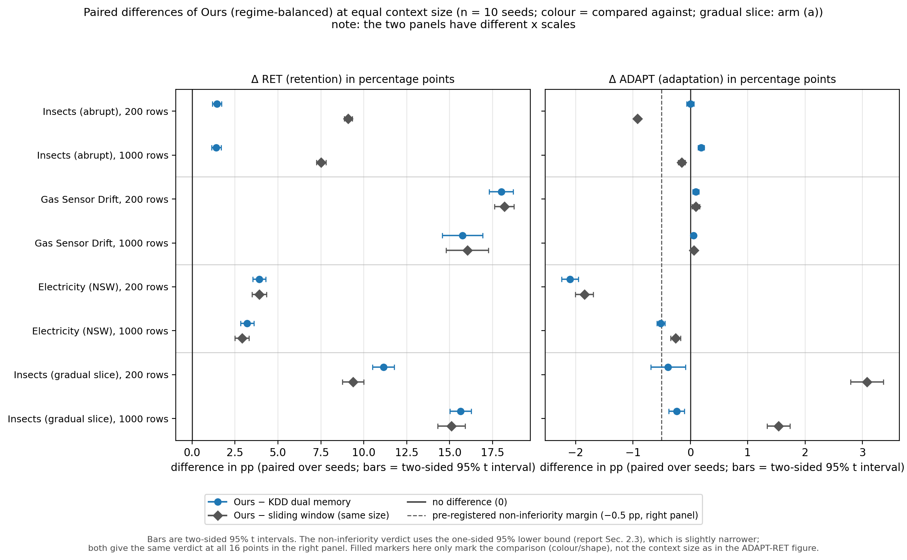
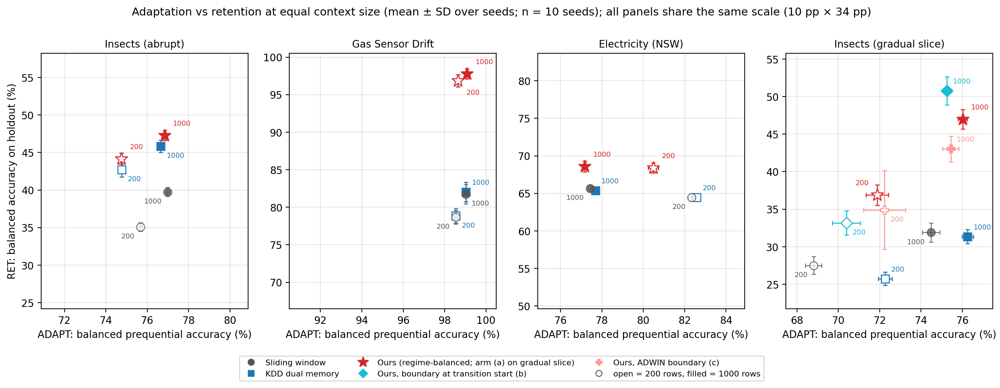
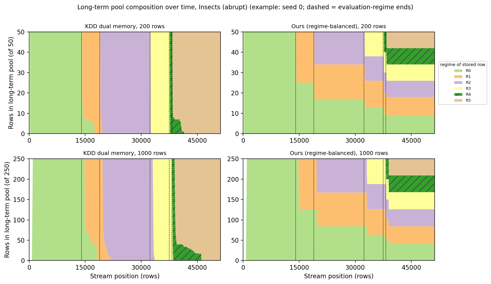
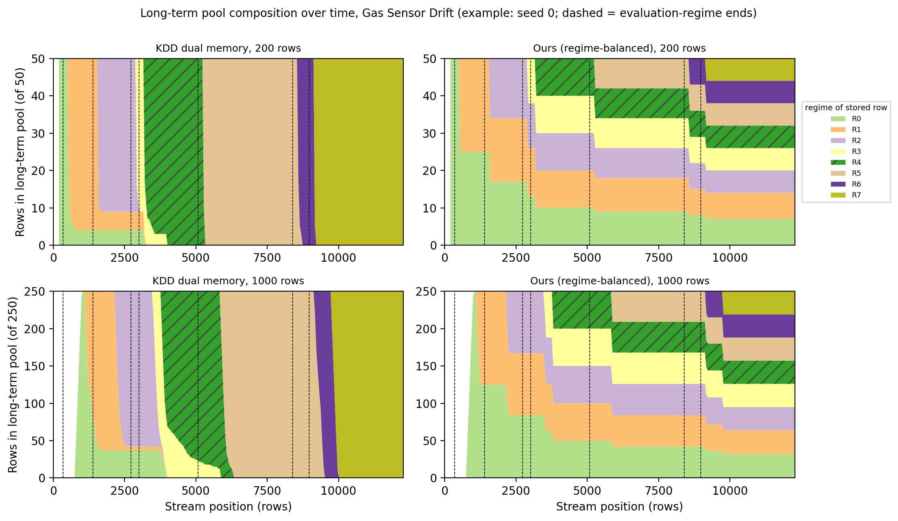
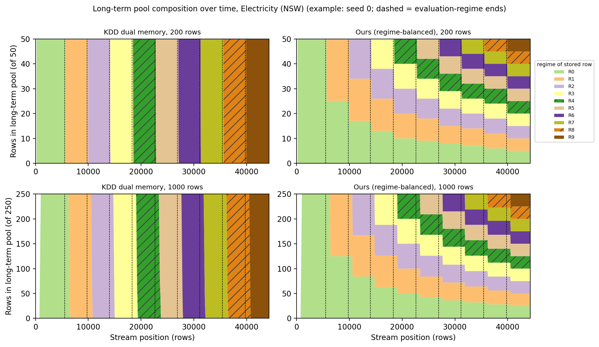
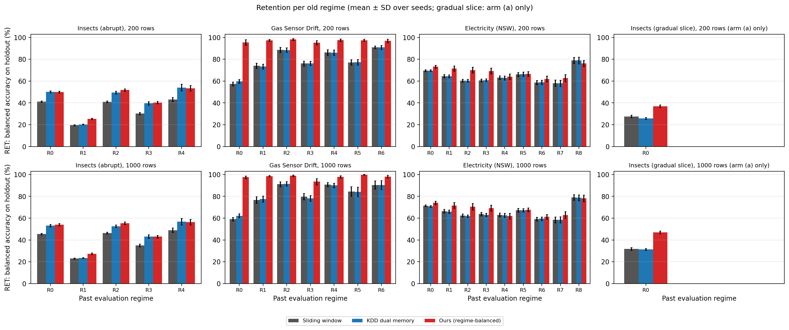
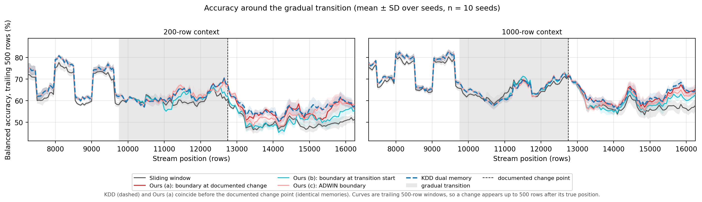
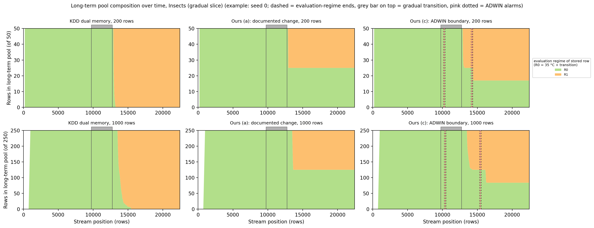

# Round 3：阶段均衡的上下文记忆在哪些数据流上有帮助（4 条流，10 seeds，GPU）

预注册见 [phase56_prereg.md](phase56_prereg.md)（修订 3，以及其后的 "Note added after a pre-flight review"）。本文件报告结果。**第三轮没有成功门槛**：预注册只问"阶段均衡在什么情况下有帮助"，所以下面的 p 值和非劣性判定都是描述，不是通过/未通过的判决。格式与第二轮结果文件 [phase56_round2.md](phase56_round2.md) 相同。

**一句话结论：** 在 4 条流（Insects 突变、Gas Sensor、Electricity、Insects 渐变切片）和两种上下文规模（200 行、1000 行）上，阶段均衡的双记忆（ours，使用官方阶段边界）的保留（RET）都比 KDD 2026 的双记忆高：8 项比较在 Holm 校正后全部显著，每一项都是 10/10 个 seed 为正，增益从 Insects 的 +1.4 pp 到 Gas 的 +15.7 / +18.0 pp。但是在 Gas 和 Electricity 上，KDD 双记忆保留的旧阶段与同规模滑窗几乎一样多（RET 差 −0.30 到 +0.28 pp），所以在这两条流上"胜过 KDD"接近"胜过不保留旧阶段"；渐变段上 KDD 的 RET 也接近滑窗（−1.77 / −0.53 pp），但原因不同（第 3.1 节）。保留的增益没有转化为流上准确率的明显提升（第 6 节）：相对同规模滑窗，ours 的 ADAPT 在 Insects 和 Electricity 两种规模上都更低（−0.15 到 −1.85 pp，均为 0/10 个 seed 为正），其中 200 行的两项（Insects −0.92、Electricity −1.85）超出 −0.5 pp 的非劣性边界。适应（ADAPT）相对 KDD 也没有处处不差：Electricity 200 行（相对 KDD −2.10 pp）、Electricity 1000 行（−0.51 pp）和渐变段 200 行（−0.39 pp，下界 −0.63）没有过 −0.5 pp 的非劣性边界。**一条重要的局限：** ours 按评估阶段均衡长期池，而 RET 正是对评估阶段等权平均，两者的单位相同，所以 RET 这个指标本身对 ours 有利；不知道阶段边界时的情况只在渐变段测过（第 4 节的 (b)(c) 臂，第 6 节）。



**图 0（总览）** 每一行是一个（数据流，规模），画的是 ours 与另一种方法的**配对差**（10 个 seed，横线是双侧 95 % t 区间）。颜色表示"跟谁比"，不是方法：蓝色圆点 = ours − KDD 双记忆，灰色菱形 = ours − 同规模滑窗（两者都是实心；这里的实心 / 空心**不**表示上下文规模，与图 1 不同）；渐变段用的是 (a) 臂。**两栏的横轴刻度不同**：左栏约 0–19 pp，右栏约 −2.5 到 3.4 pp，所以不能用线段的长短直接比较 ADAPT 的代价和 RET 的增益（例如 Electricity 200 行的 ADAPT 代价 −2.10 pp 与 RET 增益 +3.91 pp 在图上离 0 的距离看起来差不多，但数值不同）。**左栏**是保留（RET）的差，越往右 ours 越好：16 个点全在 0 的右边，没有一个区间碰到 0，也就是 ours 对 KDD 和对滑窗都更能记住旧阶段；注意 Gas 和 Electricity 上蓝点与灰点几乎重合，因为那里 KDD 本身就接近滑窗（第 3.1 节）。**右栏**是适应（ADAPT）的差，虚线是预先登记的 −0.5 pp 非劣性边界，**判定看区间下界，不看点**（第 2.3 节）。注意图里画的是双侧 95 % 区间，而非劣性判定用的是**单侧** 95 % 下界（等于双侧 90 % 区间的下界，比图里的横线端点略窄；例如渐变段 200 行对 KDD，图中下端是 −0.69，第 2.3 节的下界是 −0.63）；这 16 个点上两种下界给出的判定完全相同。多数行的代价接近 0；Electricity 200 行的两个点和 1000 行对 KDD 的点在虚线左侧，Insects 200 行对滑窗（约 −0.9 pp）也在左侧；渐变段 200 行对 KDD 的点（约 −0.4 pp）在虚线右侧，但区间越过了虚线，所以也记为没过边界。渐变段对滑窗的 ADAPT 差为正，但 KDD 自己就比滑窗高（第 1 节）。数字见第 2.2、2.3 节，图由 `scripts/plot_round3.py` 生成。

- 本文的数字都来自 `scripts/analyze_round3.py` 对原始结果文件（npz）的汇总，完整的自动报告（a–k 各小节）是 [round3_analysis.md](round3_analysis.md)，下文用"报告 a 段"等指它的小节。原始 npz 较大，没有放进仓库；逐 seed 的数字在 [round3_per_seed.csv](round3_per_seed.csv)
- ± 是 10 个 seed 之间的样本标准差。差值检验都是配对检验，括号内是差值为正的 seed 数
- 准确率一律为**平衡准确率**，单位 %；差值单位 pp
- **哪些指标是什么时候定下的：** 预注册和预注册 Note 里列出的指标（主表、第 2 节、渐变段的臂与 ZONE、ADWIN 逐 seed 报警、AUC）见预注册；下面这些是看过第三轮全部结果之后补的描述性指标，不是事先指定的：KDD − 滑窗的配对差（报告 b 段）、渐变段的 (b) − (a) 与 (c) − (a)、最终长期池构成与逐类召回（e 段）、按批揭示的基线（g 段）、掩码比例的两种分母（h 段）、阶段结束后记忆里还剩什么（i 段）、各阶段流上准确率差（j 段）、渐变段 (a)(b)(c) 臂差异的探索性分析（k 段，第 4.4 节）。AUC（f 段）是在看过 Gas 的 CPU 结果之后、GPU 运行之前定义的（预注册 Note）。本文里的"审查"只指预注册 Note 说的那次 GPU 运行之前的预检
- **来源提示：** Insects 的 `sw200`、`sw1000`、`dual1000`、`dual1000_rb` 共 40 个运行直接取自第二轮；第三轮新跑的 Insects 运行只有 `dual200`、`dual200_rb`。所以 Insects 1000 行的结果（+1.42 pp）与第二轮是**同一批文件**（第二轮在这批文件上预注册的 +2 pp 门槛（H3）没有达到；第三轮不设门槛，这里只是描述），不是独立重复，而且这一项在修订 3 之前就已经知道，在 Holm 家族里不算确认性检验。新跑的只有 200 行规模（+1.45 pp）；它与第二轮用同一条流和同一套留出集，只是规模不同，不是独立的复现。Insects 200 行的 ours − 滑窗配对用的是两个代码版本的运行：`sw200` 来自第二轮，`dual200_rb` 来自第三轮；流、留出集、检查点和 `n_estimators` 都相同，只是 commit 不同（各数据集用到的 commit 见报告开头的表）

## 1. 设置与主表

**数据流**（细节见预注册修订 3）：

| 流 | 漂移类型 | 评估阶段 | 留出集 | 说明 |
|---|---|---|---|---|
| `insects` | 突变（温度） | R0–R5，5 个已结束阶段 | 1620 行 | 第二轮的流与留出集，未改 |
| `gas` | 传感器老化，不重复 | 8 个阶段，7 个已结束 | 1635 行 | 10 个按时间排序的批次，其中两处合并；每批内部用固定 seed 打乱一次，所以 10 个 seed 的流相同 |
| `electricity` | 季节性，部分重复 | 10 个阶段，9 个已结束 | 1000 行 | 标签 = `nswprice` 是否高于前 48 行（24 小时）的均值 |
| `insects_gradual` | 渐变（35 °C 与 23 °C 实例交错） | R0（35 °C + 过渡区）、R1（23 °C），1 个已结束 | 550 行 | 过渡区 = 流内 [9750, 12750)，文档变点 12750；过渡区的行不进留出集。流内下标是去掉留出集之后的行号；对应原文件 [55,158, 58,158)（预注册里切片内的 [10,000, 13,000)），变点 58,159（从 1 开始计数）。该文件是类别不平衡版本（seed 0 的流里最少的类只占 1.2 %，最多的占 28.2 %） |

**协议、模型与方法。** 协议与第二轮相同：从第 200 行起每批 50 行，先预测、再揭示标签、再更新记忆；每 500 行和每个阶段结束时用当前记忆预测所有已出现阶段的留出集。TabPFN 6.4.1，权重冻结，`n_estimators = 4`，seed 0–9。比较三种方法，每种用 200 行和 1000 行两种规模：

| 角色 | 200 行 | 1000 行 |
|---|---|---|
| 滑窗（TabPFN 单独用） | `sw200` | `sw1000` |
| KDD 双记忆（短期 FIFO + 长期池，按类别淘汰） | `dual200`（150 + 50） | `dual1000`（750 + 250） |
| ours（长期池按"阶段 × 类别"淘汰） | `dual200_rb` | `dual1000_rb` |

在渐变段上，"阶段边界"不明确，所以 ours 有三个臂：(a) 在文档变点 12750 关闭 R0（与 Insects 相同的规则，进入主表和 Holm）；(b) 在过渡区起点 9750 关闭，这是用了事后才知道的过渡区起点的参照臂，不可部署；(c) 由 ADWIN 在方法自身的错误上报警来关闭（δ = 0.002，冷却 300 行，最短阶段 500 行，与修订 2 相同）。三个臂的评估阶段与留出集相同。

**指标** 定义同第二轮（ADAPT、ADAPT (masked)、RET、FGT）。渐变段另加：ZONE（过渡区内流上的平衡准确率）、ZONE_T1–T3（过渡区三等分）、ZONE_500（过渡区开始后 500 行）。ADAPT (masked) 的单类长段掩码是为 Insects 设计的，它去掉的流行比例：Gas 和渐变段 0 %，Insects 约 6.3 %，Electricity 约 14 %（报告 h 段；以已预测的行为分母，各 seed 13.96–14.67 %，seed 0 为 14.18 %；那里 ≥ 30 个相同标签的连续段是正常的自相关）。所以 Gas 与渐变段的 ADAPT 和 ADAPT (masked) 两列完全相同。

**可信度。** 第三轮 240 个运行（另有 2 个校准用的试跑文件，文件名带 `_calib3`、seed 0，不进分析）加第二轮 Insects 的 40 个，共 280 个，28 个（数据集, 方法）都有全部 10 个 seed，没有缺失。第三轮 240 个文件都来自同一个代码版本，GPU，`n_estimators = 4`，完整流。上下文泄漏计数全为 0，上下文不超预算，同一（数据集, seed）内流、留出集、检查点一致。用只依赖标签的记忆重放核对了 200 个运行，每个检查点的记忆摘要都与 npz 一致，0 个失败（报告"重放校验合计"）。这 200 个是：4 条主流 × 2 个规模 × （KDD 与 ours 各 1 种）× 10 个 seed = 160 个，加上渐变段两个 ADWIN 臂 20 个，再加上渐变段 (b) 臂 20 个。没有重放的 80 个是滑窗运行（它的记忆按定义就是最近 N 行，没有可重放的淘汰规则）。Insects 的第二轮与第三轮文件逐 seed 比过：流、留出集、阶段边界、检查点完全相同，已预测行数都是 51,028。

### 主表（10 个 seed，均值 ± SD，%）

渐变段的 ours 是 (a) 臂。

| 数据流 | 规模 | ADAPT 滑窗 | ADAPT KDD | ADAPT ours | RET 滑窗 | RET KDD | RET ours |
|---|---|---|---|---|---|---|---|
| insects | 200 | 75.68 ± 0.07 | 74.76 ± 0.05 | 74.76 ± 0.08 | 35.08 ± 0.58 | 42.72 ± 0.94 | **44.17 ± 0.76** |
| insects | 1000 | 76.99 ± 0.08 | 76.65 ± 0.06 | 76.84 ± 0.06 | 39.76 ± 0.60 | 45.86 ± 0.81 | **47.27 ± 0.65** |
| gas | 200 | 98.54 ± 0.08 | 98.55 ± 0.07 | 98.64 ± 0.09 | 78.67 ± 0.89 | 78.85 ± 0.97 | **96.85 ± 0.81** |
| gas | 1000 | 99.02 ± 0.05 | 99.03 ± 0.07 | 99.09 ± 0.05 | 81.74 ± 1.31 | 82.02 ± 1.29 | **97.76 ± 0.66** |
| electricity | 200 | 82.33 ± 0.17 | 82.58 ± 0.16 | 80.48 ± 0.25 | 64.48 ± 0.48 | 64.48 ± 0.42 | **68.39 ± 0.66** |
| electricity | 1000 | 77.43 ± 0.09 | 77.68 ± 0.09 | 77.17 ± 0.12 | 65.68 ± 0.41 | 65.38 ± 0.40 | **68.59 ± 0.72** |
| insects_gradual | 200 | 68.80 ± 0.39 | 72.27 ± 0.33 | 71.88 ± 0.54 | 27.52 ± 1.17 | 25.74 ± 0.89 | **36.89 ± 1.38** |
| insects_gradual | 1000 | 74.48 ± 0.42 | 76.25 ± 0.27 | 76.01 ± 0.22 | 31.89 ± 1.28 | 31.36 ± 0.92 | **46.99 ± 1.29** |

FGT（最佳 − 最终留出准确率，越小越好，各已结束阶段平均；对最后一个检查点很敏感，只作参考）：

| 数据流 | 规模 | 滑窗 | KDD | ours |
|---|---|---|---|---|
| insects | 200 | 46.08 | 20.26 | 19.44 |
| insects | 1000 | 38.51 | 21.41 | 20.11 |
| gas | 200 | 19.72 | 18.90 | 1.83 |
| gas | 1000 | 21.00 | 20.53 | 2.02 |
| electricity | 200 | 11.61 | 11.60 | 9.66 |
| electricity | 1000 | 13.69 | 13.56 | 13.66 |
| insects_gradual | 200 | 53.64 | 59.56 | 43.60 |
| insects_gradual | 1000 | 52.72 | 55.24 | 39.32 |



**图 1** 各数据流的 ADAPT–RET 散点（10 个 seed 的均值，误差棒为 ±1 SD；越靠右上越好）。空心 = 200 行，实心 = 1000 行；灰圆 = 滑窗，蓝方块 = KDD，红星 = ours。**四个子图的刻度宽度完全相同**（横向 10 pp、纵向 34 pp，每个子图以自己的数据居中，刻度间隔也相同；Gas 子图的数据靠近 100 %，因为准确率不会超过 100 %，它的窗口整体下移、上限取 100.5，宽度不变），所以点与点的距离和误差棒可以直接跨数据流比较，例如 Gas 上 RET 的差距比 Insects 上大得多。读法：每个数据流上，红星（ours）的 RET 都高于同规模的蓝方块（KDD）和灰圆（滑窗）；横向看，ours 相对 KDD 的 ADAPT 差在 Insects、Gas、渐变段都很小（不超过 0.4 pp；但渐变段 200 行的 −0.39 pp 区间下界越过了 −0.5 pp 边界，见图 0 与第 2.3 节），只有 Electricity 明显偏左（200 行 −2.10 pp）。Gas 的点几乎排成一条竖线：各方法的 ADAPT 相差不到 1 pp，差别全在 RET；Gas 和 Electricity 上滑窗与 KDD 的点几乎重合（滑窗圆点画成半透明，盖在 KDD 方块上时仍能看到蓝色的边），同一规模的点只能靠颜色和标注区分。渐变段子图的红星是 (a) 臂，另画了 (b)（青色菱形）和 (c)（粉色加号）两个臂，主表只用 (a)，三个臂见第 4 节。

几个直接从表里能看到的事：

- **Electricity 上更大的上下文反而让适应更差：** `sw1000` 77.43 < `sw200` 82.33（−4.9 pp），`dual1000` 77.68 < `dual200` 82.58。这一现象在预注册审查期间的 CPU 抽样中已经见过（约 81 % 对 76 %，第 6 节），不是看到全部结果后才发现的。
- **Gas 的 ADAPT 已经接近上限**（98.5–99.1 %），ours 的 +0.05 到 +0.10 pp 在这个范围内没有实际意义。
- **渐变段上 ours (a) 的 ADAPT 比滑窗高（+3.08 / +1.53 pp），但这部分优势不能归功于阶段均衡**：KDD 双记忆相对滑窗已经有 +3.47 / +1.78 pp，ours − KDD 为 −0.39 / −0.24（第 3 节）。渐变段是类别不平衡的流，按类别淘汰的长期池在平衡准确率上可能有利，这可能是双记忆 ADAPT 高于滑窗的原因（未验证）。

## 2. 预注册的分析

### 2.1 RET：ours − KDD（Holm 校正，8 项）

家族 = 4 个数据流 × 2 个规模，双侧配对 t 检验；渐变段用 (a) 臂。

| 数据流 | 规模 | RET 差 [95 % CI] | p（未校正） | p（Holm） | 正号 seed |
|---|---|---|---|---|---|
| insects | 200 | +1.45 [+1.19, +1.71] | 5.26e-07 | 1.05e-06 | 10/10 |
| insects | 1000 | +1.42 [+1.15, +1.69] | 8.65e-07 | 1.05e-06 | 10/10 |
| gas | 200 | +18.00 [+17.31, +18.69] | 6.08e-13 | 4.87e-12 | 10/10 |
| gas | 1000 | +15.74 [+14.56, +16.93] | 2.42e-10 | 1.21e-09 | 10/10 |
| electricity | 200 | +3.91 [+3.53, +4.29] | 2.41e-09 | 9.66e-09 | 10/10 |
| electricity | 1000 | +3.21 [+2.82, +3.60] | 1.67e-08 | 5.02e-08 | 10/10 |
| insects_gradual | 200 | +11.15 [+10.51, +11.78] | 2.02e-11 | 1.21e-10 | 10/10 |
| insects_gradual | 1000 | +15.63 [+15.02, +16.24] | 6.87e-13 | 4.87e-12 | 10/10 |

8 项在 Holm 之后全部显著。Insects 上的 +1.42 / +1.45 pp 在第二轮的预注册判定里没有达到 +2 pp 的门槛（H3）；第三轮不设门槛，这里只是描述，不能当作通过。RET 按评估阶段等权平均，与 ours 的均衡单位相同，所以这个指标对 ours 有利；不知道边界时的情况见第 4 节的 (b)(c) 臂。需要同时记住：这里的 p 值只反映两种随机性（留出集抽样和 TabPFN 的随机状态），不代表结论能推广到别的数据流（见第 6 节）。Insects 1000 行这一行与第二轮是同一批文件（修订 3 之前已知，不算确认性检验）；Insects 200 行是新跑的（+1.45 pp），但它与第二轮用同一条流和同一套留出集，只是规模不同，+1.45 与 +1.42 接近不能算独立重复验证。

### 2.2 与同规模滑窗的配对差（ours − 滑窗）

| 数据流 | 规模 | RET 差 | ADAPT 差 | ADAPT (masked) 差 |
|---|---|---|---|---|
| insects | 200 | +9.09（10/10） | −0.92（0/10） | −0.79（0/10） |
| insects | 1000 | +7.51（10/10） | −0.15（0/10） | −0.28（0/10） |
| gas | 200 | +18.18（10/10） | +0.10（9/10） | +0.10（9/10） |
| gas | 1000 | +16.03（10/10） | +0.07（10/10） | +0.07（10/10） |
| electricity | 200 | +3.91（10/10） | −1.85（0/10） | −1.63（0/10） |
| electricity | 1000 | +2.91（10/10） | −0.26（0/10） | −0.30（0/10） |
| insects_gradual | 200 | +9.37（10/10） | +3.08（10/10） | +3.08（10/10） |
| insects_gradual | 1000 | +15.10（10/10） | +1.53（10/10） | +1.53（10/10） |

### 2.3 ADAPT 非劣性（边界 −0.5 pp，单侧 95 % 下界；描述性，不是门槛）

单侧 t 检验与第二轮 H2 相同，但原始版与 masked 版分别报告，不合并取较大的 p，也不用"至少 9/10 个 seed"的符号规则。下表是原始版（masked 版的"是/否"判定全部相同）。

| 数据流 | 规模 | ours − KDD：均值（下界） | 过 −0.5？ | ours − 滑窗：均值（下界） | 过 −0.5？ |
|---|---|---|---|---|---|
| insects | 200 | −0.00（−0.05） | 是 | −0.92（−0.96） | **否** |
| insects | 1000 | +0.19（+0.15） | 是 | −0.15（−0.20） | 是 |
| gas | 200 | +0.09（+0.05） | 是 | +0.10（+0.04） | 是 |
| gas | 1000 | +0.05（+0.04） | 是 | +0.07（+0.04） | 是 |
| electricity | 200 | −2.10（−2.22） | **否** | −1.85（−1.97） | **否** |
| electricity | 1000 | −0.51（−0.57） | **否** | −0.26（−0.33） | 是 |
| insects_gradual | 200 | −0.39（−0.63） | **否** | +3.08（+2.85） | 是 |
| insects_gradual | 1000 | −0.24（−0.35） | 是 | +1.53（+1.37） | 是 |

没过边界的地方，如实列出：

- **相对 KDD 三项：** Electricity 200 行（−2.10，0/10 个 seed 为正）；Electricity 1000 行（−0.51，下界 −0.57，0/10；masked 版均值 −0.50、下界 −0.56、单侧 p = 0.46，判定相同）；渐变段 200 行（−0.39，下界 −0.63，单侧 p = 0.21，1/10）。
- **相对滑窗两项：** Insects 200 行（−0.92）和 Electricity 200 行（−1.85）。
- **过了边界、但仍为负（0/10 个 seed 为正；p 为双侧、未校正）：** 渐变段 1000 行相对 KDD −0.24 [−0.38, −0.10]，p = 0.0032；Insects 1000 行相对滑窗 −0.15 [−0.21, −0.09]，p = 2.7e-4；Electricity 1000 行相对滑窗 −0.26 [−0.34, −0.17]，p = 8.6e-5。
- **Insects 200 行的 −0.92 可以由双记忆结构解释，不是阶段均衡带来的：** KDD 双记忆相对滑窗同样是 −0.92，ours − KDD 为 −0.00 [−0.06, +0.06]。

## 3. 机制

`dual*` 与 `dual*_rb` 的淘汰规则只依赖标签和阶段号，与 TabPFN 的预测无关，所以可以只回放记忆本身，不调用模型。下面的长期池组成取自 seed 0 的回放，只作示例；图和表都在阶段边界与流末取值。

### 3.1 Gas、Electricity 上 KDD 双记忆的内容接近滑窗；渐变段上 KDD 的 RET 与滑窗相近

（报告 c 段）每批更新后，记忆行集合落在"最近 N 个已揭示行"（N = 记忆预算，即同规模滑窗）里的比例（10 个 seed，记忆已满时的均值；%）：

| 数据流 | 规模 | KDD | ours |
|---|---|---|---|
| insects | 200 / 1000 | 91.74 / 92.61 | 83.77 / 84.58 |
| gas | 200 / 1000 | 94.67 / 95.59 | 80.19 / 80.98 |
| electricity | 200 / 1000 | 95.95 / 97.49 | 82.08 / 82.60 |
| insects_gradual | 200 / 1000 | 90.35 / 91.05 | 88.28 / 89.39 |

在 Gas 和 Electricity 上各类别大致均匀到来，按类别淘汰的长期池因此几乎等于"最近的行"。预注册 Note 的描述性补充提到过这一点（这条补充是在审查期间看过 Gas 的 CPU 结果之后写的，不是检验）。实测的 KDD 相对滑窗（报告 b 段的"KDD − 滑窗"行，10 个 seed 配对）：

| 数据流 | 规模 | RET：KDD − 滑窗 | ADAPT：KDD − 滑窗 |
|---|---|---|---|
| insects | 200 / 1000 | +7.64（10/10） / +6.10（10/10） | −0.92（0/10） / −0.34（0/10） |
| gas | 200 / 1000 | +0.18（6/10，p = 0.19） / +0.28（7/10，p = 0.08） | +0.00 / +0.01 |
| electricity | 200 / 1000 | +0.00（5/10，p = 0.93） / −0.30（0/10） | +0.25 / +0.26（均 10/10） |
| insects_gradual | 200 / 1000 | −1.77（0/10） / −0.53（1/10） | +3.47 / +1.78（均 10/10） |

所以：

- 只有 **Insects** 上 KDD 双记忆自己就比滑窗保留得多（+7.64 / +6.10 pp），ours 在它之上再加 +1.4 pp。
- 在 **Gas 和 Electricity** 上，KDD 的记忆与同规模滑窗重合 94.7–97.5 %，RET 相差 −0.30 到 +0.28 pp，所以 ours − KDD 的增益在这两条流上接近 ours − 滑窗。**渐变段的情况不一样：** KDD 的重合度（约 90 %）和 Insects 差不多，它的 RET 接近滑窗（−1.77 / −0.53 pp），是因为文档变点后 R0 很快被换掉（图 7），不是因为记忆和滑窗相同；KDD 在渐变段的 ADAPT 也明显高于滑窗（+3.47 / +1.78 pp）。
- 渐变段 ADAPT 上 ours 比滑窗高的 +3.08 / +1.53 pp，KDD 本来就有 +3.47 / +1.78 pp，ours − KDD 为 −0.39 / −0.24，所以这部分优势不能归功于阶段均衡；它可以由双记忆按类别淘汰的结构解释（未验证；渐变段是类别不平衡的流，见第 1 节）。
- **为什么 Insects 上 KDD 能多保留旧阶段（解释，未做消融）：** Insects 在变点之前有很长的单类段（ADAPT (masked) 去掉约 6 % 的流行），KDD 按多数类淘汰时会留下少数类的旧行；Gas 和 Electricity 没有这种段。但要承认：Insects 的重合度（91.7 / 92.6 %）与 Gas（94.7 / 95.6 %）只差几个 pp，重合度本身不足以解释 RET 的差别；渐变段 KDD 的重合度比 Insects 还低，RET 却接近滑窗。

### 3.2 长期池里留住了什么



**图 2** Insects：长期池中各评估阶段的行数随时间的变化（示例：seed 0；虚线是评估阶段结束；数据见报告 d 段）。左列 KDD，右列 ours，上排 200 行，下排 1000 行。KDD 每到一个新阶段，长期池在几千行内被新阶段的行全部换掉，同一时刻基本只存一个阶段。ours 在每个边界之后把长期池平分给所有已见阶段：流末 200 行规模每个阶段 8–9 行（共 50），1000 行规模每个阶段 41–42 行（共 250）。R4 只有 708 行，比 1000 行规模的短期队列（750 行）短，所以在 1000 行规模下，到 R4 结束时两种方法的长期池里都还没有 R4 的行（200 行规模的短期队列是 150 行，R4 的行在结束时已进入长期池）。1000 行（下排）图的最左边有一段空白：长期池还没有填，最初的 750 行（200 行规模是 150 行）先进短期队列；图 3、图 4、图 7 同。



**图 3** Gas（示例：seed 0）。KDD 并不总是只存一个阶段：它按多数类淘汰，少数类的旧行能多留一段时间（200 行规模在 1395 处是 R0 4 行 + R1 46 行，在 2731 处是 4 / 5 / 41；1000 行规模在 2731 处是 37 / 5 / 208），但旧行最终都被换掉：200 行规模到 5082 时只剩 R4，1000 行规模到 8395 时只剩 R5（5082 处还剩 R3 的 23 行），流末 50 行（或 250 行）全部来自最后一个阶段。ours 流末每个阶段 6–7 行（200 行）或 31–32 行（1000 行）。



**图 4** Electricity（示例：seed 0）。10 个评估阶段长度相近，KDD 每段都被下一段完全换掉，ours 流末每段 5 行（200 行）或 25 行（1000 行）。

池子的变化比阶段边界滞后约一个短期队列的长度（200 行规模 150 行，1000 行规模 750 行），因为新行要先经过短期 FIFO 才进入长期池；1000 行规模下，开头约 750 行之前长期池是空的。

**阶段结束后记忆里还剩多少该阶段的行**（报告 i 段，10 个 seed 的回放；"少于 5 行"是指整个记忆，长期加短期，含该阶段的行不足 5 行，占阶段结束之后各次更新的比例）：

| 数据流 | KDD 200 行 | KDD 1000 行 | ours（两种规模） |
|---|---|---|---|
| insects | 81.5–99.1 % | 39.8–93.4 % | 0 % |
| gas | 83.6–97.9 % | 69.5–87.9 % | 0 % |
| electricity | 96.7–99.5 % | 78.0–97.4 % | 0 % |
| insects_gradual（R0） | 96.9 % | 74.0 % | 0 % |

另外（报告 i 段）：Gas 上每个阶段刚结束的那次更新时，KDD 长期池里平均有 93.7 % 是刚结束阶段的行（200 行规模；1000 行规模 56.9 %），ours 为 36.6 % / 19.9 %。阶段结束之后，长期池里该阶段的平均行数：Gas 上 KDD 为 0.7–2.4 行（200 行）和 13.2–58.3 行（1000 行），ours 为 6.0–11.6 行和 30.2–56.7 行。ours 的整个记忆（长期加短期）里旧阶段不足 5 行的比例总是 0 %；但 Gas 1000 行规模下长期池里该阶段的行数最少出现过 0：R6 只有 580 行（8395–8975），比 750 行的短期队列短，所以刚结束时它的行还在短期队列里，长期池里没有（见报告 d 段边界 8975）。流末时每个旧阶段在池里的行数与类别覆盖：Gas 200 行规模每个阶段 6–7 行，每个留出集的类平均 1.1 行（1–2）；1000 行规模 31–32 行，每个类平均 5.5 行（5–7）；360/360 个（阶段，类，seed）都被覆盖，KDD 为 0/360。Insects、Electricity、渐变段上 ours 也是 300/300、180/180、50/50 全部覆盖，KDD 都是 0。

### 3.3 各阶段的增益



**图 5** 各旧阶段的保留（10 个 seed 的均值 ± SD；灰 = 滑窗，蓝 = KDD，红 = ours；数据见报告 a 段；上排 200 行，下排 1000 行）。渐变段只有一个旧阶段 R0，那一列只画了 (a) 臂（右侧留白是为了让柱宽与其他子图相近）。

- **Gas：** ours 在 7 个旧阶段都明显更高（相对 KDD +5.96 到 +35.67 pp，最大在最早的 R0：+35.67 / +35.26 pp）。滑窗（200 行）在旧阶段上只有 57.41（R0）到 90.99（R6），ours（200 行）在每个阶段都有 95.19–98.19。阶段之间几乎完全可分（见 3.4 的 AUC 0.992–1.000）。推测：Gas 的传感器漂移把特征移到新数据不再覆盖的区域，一旦记忆里没有这个阶段的行，它的留出准确率就掉到 57–91 %，每阶段只留几行（200 行规模 6–12 行）就能拉回到 95–98 %；回放显示流末这几行大致每类 1 行，覆盖了该阶段留出集的全部类。这是由 AUC 和行数推出的解释，没有做消融。
- **Electricity：** 增益不均匀。R0–R3 为 +3 到 +10 pp（200 行：+3.55 / +7.17 / +9.73 / +8.31）；R4、R5 不显著（200 行 +1.14 / +0.09，1000 行 −0.76 / +0.36）；R6、R7 为正；R8 为负（200 行 −2.63，0/10；1000 行 −0.60，p = 0.12）。1000 行时 FGT 差为 +0.10 [−0.62, +0.82]，没有改善。
- **Insects：** 增益集中在 R1、R2（200 行 +5.03 / +2.30，1000 行 +3.95 / +2.76）；R3、R4 接近零（−0.60 到 +0.75，只有 200 行 R3 的 +0.75 勉强为正，p = 0.032，未校正）。两个规模的模式一致；R0 上两者略有不同（200 行 −0.21 不显著，1000 行 +0.87）。
- **渐变段：** 唯一的旧阶段 R0，ours (a) 36.89 对 KDD 25.74（200 行）、46.99 对 31.36（1000 行）。

**解读负值时要注意：** RET_Rj 是阶段 j 结束之后所有检查点上留出准确率的平均，所以靠近流末的阶段（Electricity R8、Insects R4、Gas R6）只在结束后很短的窗口里被测量，而 KDD 的记忆刚刚被这些阶段填满；那里增益小或为负，不能读成"ours 遗忘了最后一个阶段"。

### 3.4 阶段差异与增益（探索性，在看过 Gas 的 CPU 结果之后定义）

这个度量是在看过 Gas 各阶段保留之后才选定的，所以只作探索性描述，不是检验。阶段 j 的"差异" = 用逻辑回归区分阶段 j 与之后所有阶段的标准化特征，5 折分层交叉验证 ROC-AUC 的均值；增益 = RET_Rj(ours) − RET_Rj(KDD)。

- **数据流之间：** 以 KDD 为参照时，平均 AUC 与平均增益的顺序相同（平均 AUC 取自报告 f 段各阶段 AUC 的平均）：insects 0.697（+1.45 / +1.42）< electricity 0.737（+3.91 / +3.21）< insects_gradual 0.814（+11.15 / +15.63）< gas 0.997（+18.00 / +15.74）。但这只有 4 个点；1000 行时渐变段 +15.63 与 Gas +15.74 只差 0.11 pp，顺序几乎是并列；而且换成 ours − 滑窗（第 2.2 节）顺序就变了：Insects（RET +9.09 / +7.51）大于 Electricity（+3.91 / +2.91），但 Insects 的 AUC 更低。所以 KDD 参照下 Insects 增益小，主要是因为 KDD 在 Insects 上本来就保留了旧阶段，与阶段可分性关系不大。
- **数据流内部：** 看不到"阶段越不同、增益越大"。AUC 与增益的 Spearman 相关：insects +0.50（200 行）/ +0.20（1000 行），electricity +0.23 / +0.18，都不显著；gas −0.86 / −0.68，方向相反（Gas 的 AUC 全在 0.992–1.000，已到上限，没有区分度）。把所有数据流合在一起得到的 ρ ≈ +0.69（报告 f 段）是数据流之间的差异造成的，两种规模合并还把同一个 AUC 算了两次，不能当作阶段层面的证据，这里也不引用它的 p 值。

结论只能写成：4 条流上，平均 AUC 的顺序与 ours − KDD 增益的顺序一致；但只有 4 个点，度量是事后选的，而且换成 ours − 滑窗时 Insects 与 Electricity 的顺序反过来。所以这只是一个待检验的猜想，在数据流层面和阶段层面都没有得到证实。

### 3.5 Electricity 上 ADAPT 的代价

ours − KDD 的 ADAPT 在 Electricity 上是 −2.10 [−2.25, −1.95]（200 行）和 −0.51 [−0.58, −0.44]（1000 行），都是 0/10 个 seed 为正。这个代价分散在整条流上，不是集中在阶段切换之后（报告 j 段）：200 行时，R1–R9 各阶段流上的平衡准确率 ours − KDD 全为负（−0.63 到 −5.15 pp，R0 为 0，因为第一次关闭阶段之前两者相同）；1000 行时各阶段的值有正有负（−2.83 到 +0.93）。

可能的原因（解释，未做消融）：Electricity 的标签是"价格是否高于前 24 小时的均值"，这个均值不是特征，所以任务奖励跟踪最近的价格水平，旧数据即使在滑窗里也有害（`sw200` 82.33 > `sw1000` 77.43）。长期池里行的年龄的中位数（记忆已满之后，10 个 seed 平均）：200 行规模 KDD 176 行（约 3.7 天）、ours 8448 行（约 176 天）；1000 行规模 KDD 876 行（约 18.2 天）、ours 8959 行（约 186.6 天）；数据见报告 i 段。ours 在 200 行时把 3–4 天前的新鲜行换成了半年前的行，代价大（−2.10）；1000 行时 KDD 的长期行本来就约 18 天前，换掉损失小（−0.51）。

## 4. 渐变段

阶段 R0 = 35 °C + 过渡区，R1 = 纯 23 °C。**记忆里的阶段与评估阶段不是一回事**：(a) 臂在文档变点 12750 才关闭 R0，所以它的"R0 行"里含过渡区的行；但 R0 的留出集只含纯 35 °C 的行（过渡区的行不进留出集）。下面各表中"R0 行"一律指评估阶段 R0（35 °C + 过渡区）的行。本节的数字来自报告 e 段。

### 4.1 三个臂

| 臂 | 规模 | RET | ADAPT | ZONE | ZONE_T1 | ZONE_T2 | ZONE_T3 | ZONE_500 |
|---|---|---|---|---|---|---|---|---|
| 滑窗 | 200 | 27.52 ± 1.17 | 68.80 ± 0.39 | 61.13 ± 0.45 | 60.61 | 58.38 | 61.99 | 60.30 ± 0.62 |
| KDD | 200 | 25.74 ± 0.89 | 72.27 ± 0.33 | 63.96 ± 0.74 | 60.10 | 62.20 | 65.52 | 59.44 ± 0.68 |
| ours (a) 官方变点 | 200 | **36.89 ± 1.38** | 71.88 ± 0.54 | 63.96 ± 0.74 | 60.10 | 62.20 | 65.52 | 59.44 ± 0.68 |
| ours (b) 过渡区起点 | 200 | 33.17 ± 1.61 | 70.39 ± 0.67 | 62.21 ± 0.54 | 60.62 | 60.59 | 62.66 | 60.03 ± 0.62 |
| ours (c) ADWIN | 200 | 34.89 ± 5.25 | 72.22 ± 1.01 | 63.87 ± 0.67 | 59.90 | 63.12 | 65.16 | 59.44 ± 0.68 |
| 滑窗 | 1000 | 31.89 ± 1.28 | 74.48 ± 0.42 | 66.76 ± 0.16 | 60.37 | 65.67 | 68.70 | 62.02 ± 0.72 |
| KDD | 1000 | 31.36 ± 0.92 | 76.25 ± 0.27 | 67.07 ± 0.18 | 60.56 | 65.22 | 69.74 | 63.25 ± 1.01 |
| ours (a) 官方变点 | 1000 | 46.99 ± 1.29 | 76.01 ± 0.22 | 67.07 ± 0.18 | 60.56 | 65.22 | 69.74 | 63.25 ± 1.01 |
| ours (b) 过渡区起点 | 1000 | **50.78 ± 1.89** | 75.24 ± 0.23 | 67.33 ± 0.28 | 60.51 | 65.97 | 69.94 | 63.25 ± 1.01 |
| ours (c) ADWIN | 1000 | 43.04 ± 1.70 | 75.43 ± 0.39 | 67.06 ± 0.25 | 60.56 | 64.64 | 70.32 | 63.25 ± 1.01 |



**图 6** 渐变段流上准确率（向后 500 行窗口，10 个 seed 的均值 ± SD；横轴约 7,300–16,250；灰色区是过渡区 9750–12750，黑色虚线是文档变点 12750；灰 = 滑窗，蓝色粗虚线 = KDD，红 = ours (a)，青 = (b)，粉 = (c)）。曲线是向后 500 行的窗口，所以变化相对真实位置最多滞后 500 行。12750 之前 ours (a) 与 KDD 的记忆完全相同，红线被画在蓝色虚线之下或与之重合（(c) 在第一次报警之前也与它们相同）。图中变点之后（12,750–16,250）各方法的最低点约为 45–50 %（200 行；滑窗 46.4 %，(b) 45.2 %）和 53–57 %（1000 行；滑窗 53.4 %，(b) 54.3 %）（均为 10 个 seed 的平均曲线）。变点之后约 13,000–14,500 之间，(b) 臂与滑窗一样低，多数格点上还更低（每 50 行一个格点，200 行：(b) 最低 20 点、滑窗 14 点；1000 行：(b) 16 点、滑窗 13 点、(c) 5 点）；14,500 之后两种规模下滑窗基本都是最低一档（200 行有 3 个格点是 (b)）。这张图只显示适应（流上准确率），不显示保留。

配对差（pp，括号内是正号 seed 数）。只有 (a) 臂的 RET 与 ADAPT 属于预注册的检验；ZONE、ZONE_500 的 p 值和 (b)(c) 臂的检验都是描述性的，不进 Holm：

| 比较 | 规模 | RET | ADAPT | ZONE | ZONE_500 |
|---|---|---|---|---|---|
| (a) − KDD | 200 | +11.15（10/10） | −0.39（1/10） | 0（结构性相同，见下） | 0（结构性相同） |
| (a) − 滑窗 | 200 | +9.37（10/10） | +3.08（10/10） | +2.84（10/10） | −0.87（1/10） |
| (b) − KDD | 200 | +7.43（10/10） | −1.88（0/10） | −1.76（0/10） | +0.59（8/10） |
| (c) − KDD | 200 | +9.15（10/10） | −0.04（6/10） | −0.09（4/10） | 0（结构性相同） |
| (a) − KDD | 1000 | +15.63（10/10） | −0.24（0/10） | 0（结构性相同） | 0（结构性相同） |
| (a) − 滑窗 | 1000 | +15.10（10/10） | +1.53（10/10） | +0.31（9/10） | +1.23（10/10） |
| (b) − KDD | 1000 | +19.42（10/10） | −1.01（0/10） | +0.27（9/10） | 0（结构性相同） |
| (c) − KDD | 1000 | +11.68（10/10） | −0.82（0/10） | −0.01（6/10） | 0（结构性相同） |

**(a) 臂在过渡区与 KDD 相同，这是结构决定的。** (a) 臂的记忆在官方变点 12750 之前不划分阶段，所以在过渡区 [9750, 12750) 里 `dual*_rb` 与 `dual*` 的预测在 10 个 seed 上逐行完全相同；第一处不同出现在 200 行时的 12,954–12,999 行、1000 行时的 13,560–13,672 行，即变点之后约一个短期队列的长度（新阶段的行要先经过短期 FIFO 才进入长期池）。因此 (a) − KDD 的 ZONE 恒为 0，p 值不存在，这一格不能当作"(a) 在过渡区没有帮助"的证据，也不能读成"0/10 个 seed 为正"表示 ours 输了。同样的原因，ZONE_500（过渡区开始后 500 行）在 (b) 的 1000 行和 (c) 的两种规模上也与 KDD 相同；(b) 在 200 行时于 9750 关闭，第一处不同出现在 9951–9986（10/10 个 seed 都在 ZONE_500 之内），所以有 +0.59；(b) 在 1000 行时是 10571–10930，在 ZONE_500 之外。ZONE 的有效比较是 (b)、(c) 相对 KDD，以及 (a) 相对滑窗。

**要点：**

- **RET：** 三个臂都远高于 KDD 和滑窗。(a)−KDD 是 +11.15 / +15.63（Holm 显著）；(b)−KDD +7.43 / +19.42，(c)−KDD +9.15 / +11.68（描述性，均 10/10）。
- **(b) 不是"上界"（(b) − (a)、(c) − (a) 是看过第三轮结果之后补的描述性比较）：** 预注册称 (b) 为 upper reference；结果表明它在 200 行时并不是上界。(b) 用了事后才知道的过渡区起点，不可部署。它的 RET 在 200 行时反而比 (a) 低（−3.72，0/10 个 seed 为正），ADAPT 也低（−1.49）；在 1000 行时 RET 比 (a) 高（+3.79，10/10），ADAPT 仍低（−0.77）。同一对臂在两种规模下顺序相反，每个 seed 都一致。回放显示 (b) 保留了 25 行真正的 35 °C 行（覆盖 6 个类），而 (a) 保留的是 25 行过渡区末段的行（见 4.2）。**200 行时 (b) 更低的原因，第 4.4 节做了探索性分析：差距几乎全部来自类 1，一个部分有证据的推测是长期池里极少见的类 3 行把类 1 的查询拉走，但没有做因果对照。** 不能写成"(b) 总是上界"。
- **(c) ADWIN 在 200 行时很不稳定：** RET 逐 seed 范围 27.52–42.10（SD 5.25，见 round3_per_seed.csv），(c) − (a) = −2.00 [−5.20, +1.21]，p = 0.19，5/10 个 seed 为正；1000 行时 (c) − (a) = −3.95（0/10）。(c) 的 ADAPT：200 行与 KDD 相当（−0.04，6/10）；1000 行比 KDD 低 0.82 pp（0/10，超出 −0.5 pp 的边界）。200 行时 (c) 比 (a) 低的原因与 (b) 不同，见 4.4。
- **过渡区内各臂差别很小：** 200 行 ZONE 为滑窗 61.13、KDD = (a) 63.96、(b) 62.21、(c) 63.87；1000 行为 66.76、67.07、67.33、67.06。差异主要出现在 RET，不在过渡区内的流上准确率。

### 4.2 各臂最终保留的是哪些行

回放得到的最终长期池组成（报告 e 段，10 个 seed 完全相同，因为淘汰只依赖标签和阶段号；行按流内位置分类）：

| 臂 | 最终长期池 |
|---|---|
| KDD | 100 % 纯 23 °C（没有 R0 的行；KDD 长期池里最后一次含 R0 的行出现在已揭示 13150–13200 行（200 行）和 15350–15650 行（1000 行），文档变点是 12750） |
| (a) 官方变点 | 50 % 来自评估阶段 R0，但其中**没有一行是纯 35 °C 的行**：全部是过渡区末三分之一（T3）的行（200 行 25/25；1000 行 124/125，另有 1 行来自 T2）；另 50 % 是纯 23 °C |
| (b) 过渡区起点 | 50 % 纯 35 °C（覆盖全部 6 个类）+ 50 % 纯 23 °C |
| (c) ADWIN | 200 行：T1 过渡区的行 34 % + 纯 23 °C 66 %；1000 行：纯 35 °C 4.0 %（只有一个类）+ T1 29.6 % + 23 °C 66.4 % |

所以 (a) 臂在纯 35 °C 的留出集上有增益，却没有保留任何纯 35 °C 的行：它保留的是过渡区末段的行（过渡区里两种温度的实例交错，所以其中仍会混有 35 °C 的实例，混入比例本文没有统计）。不能写成"ours (a) 保留了 35 °C 的行"。



**图 7** 渐变段的长期池组成（示例：seed 0；坐标轴上方的灰条（及其两端的灰色细线）= 过渡区，黑色虚线 = 文档变点，粉色点线（深色描边）= ADWIN 报警位置；图例里的 R0 是评估阶段 R0 = 35 °C + 整个过渡区）。R0 包括过渡区的行：(a) 臂流末保留的 R0 行全部来自过渡区末段，没有一行是纯 35 °C 的行（见 4.2）。ADWIN 第一次报警把 R0 内部再切成两段，两段都是评估阶段 R0 的行，所以报警之后池子仍全是 R0，直到变点之后 R1 的行进入池子（200 行约 12,950，1000 行约 13,550）。KDD 在文档变点之后把 R0 换掉（200 行在变点后约 400–450 行换完，1000 行约 2,600–2,900 行换完，即已揭示 15,350–15,650 行）；流末 R0 = 0 / 50（250）；ours (a) 流末 25 / 25（125 / 125）；ADWIN 臂 R0 占 17 / 33（1000 行：84 / 166）。

### 4.3 ADWIN 报警

每个 seed、两种规模都恰好报警 2 次，没有无报警的 seed。表中的范围与中位数都在报告 e 段每个 ADWIN 表下面的"汇总"一行（中位数不取整）。

| | 200 行 | 1000 行 |
|---|---|---|
| 第一次报警相对过渡区起点 | +488 到 +586 行（中位数 +551.5） | +306 到 +621 行（中位数 +464） |
| 第一次报警相对文档变点 | −2512 到 −2414 行 | −2694 到 −2379 行 |
| 第二次报警相对文档变点（落在 R1 内） | +752 到 +2272（中位数 +1107） | +1651 到 +2679（中位数 +2466.5） |
| 最终长期记忆中 R0 行的占比 | 34.00 %（每个 seed） | 33.60 %（每个 seed） |

- 第一次报警都落在过渡区内，比过渡区起点晚约 300–600 行，比文档变点早约 2,400–2,700 行。预注册审查期间在 CPU 上（单个 ensemble 成员，seed 0）看到的是约 300–500 行；这里以 GPU 运行的数字为准。
- 第二次报警落在 R1 里，把流切成三个记忆阶段；均衡是按记忆阶段做的，R1 占了其中两个，所以 R0 行最终只占约三分之一（对比 (a)(b) 的 50 %）。
- ADWIN 对错误率上升和下降都会报警，所以 R1 里的报警不一定对应真实变点。

### 4.4 为什么 200 行时 (b) 的 RET 比 (a) 低（探索性，看过结果之后补的）

这一节**不是预注册分析**，是看到 (b) 在 200 行更差之后为弄清"差在哪里"补做的。所有数字来自报告 k 段（`scripts/analyze_round3.py` 生成，k.1–k.7 只用已有的 npz 与标签重放；k.8 另外读了原始特征来算距离；全部没有重新运行 TabPFN）。里面的"seed 数"和 p 值都是描述性的。

**统计上的前提：10 个 seed 不是 10 个独立的"池"。** seed 只改变留出集的抽样（以及 TabPFN 的随机性）；长期池里每个类在 R0 一侧只有约 4 行（200 行；1000 行约 20 行），是流里连续的一小段，而且各 seed 之间几乎是同一批行：200 行时 (a) 臂的 50 行池，10 个 seed 里完全相同的有 33 行，并集只有 63 行；(b) 臂是 29 行相同、并集 67（1000 行：(a) 176 / 287，(b) 141 / 299；报告 k.6）。ADWIN 臂不同，它的池随 seed 变（并集 224）。所以"10/10 个 seed 里 (b) 更低"主要是在比较**两组特定的几行**，不能推出"在过渡区起点关闭阶段一般比在官方变点关闭更差"。比较稳妥的说法是：200 行时 (b) 的结果取决于恰好保留了哪几行。

**已经确认的事实（数据直接给出）：**

- **差距几乎全在类 1。** 200 行时 R0 留出集上 (b) − (a) = −3.72 pp。逐类召回（R0 结束之后各检查点的平均）：类 1 为 20.0 对 45.9（差 −25.97，10/10 个 seed 更低），这一项就贡献 −25.97 / 5 = −5.19 pp（R0 留出集有 5 个类，没有类 3）；类 0、2、5 相差不大（−1.02、−0.25、+1.51），类 4 反而更高（+7.15）；其余各类合计 +1.48 pp（报告 k.2）。
- **(b) 把类 1 的查询判成了类 3。** R0 留出集里真类 1 的查询，(b) 把 59.8 % 预测成类 3，(a) 只有 5.3 %，KDD 8.2 %，(c) 5.9 %（真实 TabPFN 预测，报告 k.3）。类 1 的行数不少：两个臂长期池里类 1 都是 8 行（4 行来自 R0 一侧，4 行纯 23 °C），所以不是"类 1 被淘汰了"。
- **什么时候开始：** 在官方变点 12750 之前 (b) 并不差：过渡区开始到 R0 结束前 750 行之间（t = 10000–11500）(b) − (a) 有正有负（−0.8 到 +1.3 pp），R0 结束前最后 750 行 (b) 反而高 +4.0 到 +5.4 pp；变点之后翻转：13000 时 (b) − (a) = −1.0（6/10 个 seed 更低），13500 时 −4.9（10/10）。变点之后 20 个检查点里 19 个平均差为负，15 个有至少 9/10 个 seed 的 (b) 更低（报告 k.1）。
- **1000 行时方向相反：** (b) − (a) = +3.79（0/10 个 seed 更低）。类 1 仍是 (b) 更低（−5.58，10/10），但类 0、4、5 大幅更高（+12.88、+6.47、+4.82）；类 1 被判成类 3 的比例也上升了（(b) 9.0 %，(a) 3.0 %），但类 1 本身还有 87.0 % 召回（(a) 92.6 %）。

**一个有部分证据的推测：极少见的类 3 行拉走了类 1。**

- 纯 35 °C 段里类 3 只有 10 行（约 0.10 %，seed 0），而类 1 占 43.7 %（报告 k.4）。类 3 在整条流里也最少（1.2 %）。
- 按类均衡的长期池仍然给这个极少见的类 3 与类 1 一样的名额：(b) 臂 200 行时纯 35 °C 的类 1、类 3 各 4 行（报告 k.5）；1000 行时类 1 是 23 行、类 3 是 10 行（把 10 行用完了）。
- 这 10 行类 3 在特征上落在类 1 中间：每一行在纯 35 °C 里的 10 个最近邻，有 9 行全是类 1，另 1 行是 9 个类 1 加 1 个类 3（seed 0，标准化后的欧氏距离，报告 k.8）。所以 (b) 的上下文里等于有 4 行"看起来像类 1、却标成类 3"的行，与 4 行真类 1 并存。这些类 3 行是标签噪声，还是两个物种在 35 °C 下真的重叠，无法判断。
- (b) 臂内部按查询的相关：对 500 个类 1 查询，算它到池里最近类 3 行与最近类 1 行的距离差（越小 = 相对越靠近类 3 行），与"被判成类 3 的检查点比例"的 Spearman 相关是 −0.56（p = 5e−43）；按距离差从小到大分四档，被判成类 3 的比例是 0.85、0.72、0.57、0.25。(a) 臂同样的检验几乎是平的（0.08、0.05、0.04、0.05；Spearman −0.16，p = 0.0002，名义上不为零，但各档比例都在 0.04–0.08 之间）（报告 k.8）。
- 翻转的时间也与这个说法相容（**未检验**）：变点之前短期窗口里还有过渡区的 35 °C 类 1 实例，能盖过这 4 行类 3；变点之后短期窗口全是纯 23 °C，35 °C 的类 1 只剩长期池里的 4 行。

**这个推测的强度。** 它有 (b) 臂内部按查询的剂量关系作支持，但没有因果证据：要确认，需要用同样的上下文，只去掉或替换那 4 行纯 35 °C 的类 3，再让 TabPFN 预测；这一步要重新运行 TabPFN，本轮没有做。推测主要来自 (b) 臂（(a) 臂的池里没有这样的纯 35 °C 类 3 行）；1000 行的 (c) 臂方向一致：它的池里也有这 10 行纯 35 °C 的类 3（没有纯 35 °C 的类 1），类 1 被判成类 3 的比例是 21.1 %，是四个臂里最高的（(a) 3.0 %，(b) 9.0 %，KDD 6.9 %；报告 k.3、k.5），但同样不是因果证据，(c) 池里还有别的差异；而且各 seed 的池几乎相同（见上），所以相关性主要反映"那几行"的作用。

**没有支持的说法：**

- "(b) 的类 1 行少或被淘汰"：不成立（见上，两臂都是 8 行）。
- "行龄 / 时间顺序造成差别"：不支持。臂内类 1 召回与检查点时刻 t 的 Spearman 是 (a) −0.15（p = 0.031）、(b) −0.06（p = 0.43）；而行龄与行的来源（纯 35 °C 或过渡区末段）在臂间完全共线，数据无法把两者分开（报告 k.7）。
- "(a) 池里的 T3 类 1 行里 35 °C 的实例更多，所以 (a) 更好"：过渡区里两种温度的实例交错，我们没有可靠的办法估计每一行属于哪种温度，所以这一条没有检验，也不写。

**(c) ADWIN 在 200 行也低于 (a)（−2.00，[−5.20, +1.21]，5/10 个 seed 为正，没有统计显著性），但原因与 (b) 不同。** (c) 的类 1 召回与 (a) 持平（45.7 对 45.9），类 1 被判成类 3 只有 5.9 %；差距来自类 0（−12.64，10/10 个 seed 更低），部分被类 4 更高（+5.19）抵消（报告 k.2）。(c) 的类 1 召回在 seed 之间差别很大（16 到 73，(a) 是 37 到 54）。**类 0 为什么低，没有解释**：(c) 池里类 0 平均是 2 行 T1 加 4 行纯 23 °C（各 seed 的 (c) 池不同，数字是 seed 平均），(b) 是 4 行纯 35 °C 加 4 行纯 23 °C（报告 k.5），(b) 的类 0 召回正常（21.9）；这是否就是原因没有检验，这里不能套用类 3 的说法。

## 5. 不用 TabPFN 的平凡基线

流上已预测行的平衡准确率（%，10 个 seed 平均；报告 g 段）。预注册写的是 "No-Change (previous label)" 和 "majority class of the last 200 rows"；实现时取的是上一行（可能尚未揭示）的标签，以及被预测行之前 200 行的多数类，按行逐个计算。但协议是每批 50 行预测完才一起揭示标签，所以这两个基线用到了批内尚未揭示的标签，**偏乐观**。下表并列加了两个"按批揭示"的参照（看过第三轮结果之后补的描述性指标，不是预注册指标），它们与 TabPFN 拥有相同的信息：No-Change_batch = 当前批开始前最后一个已揭示的标签；Majority_batch = 当前批开始前 200 个已揭示行的多数类（平票取类别编号最小者）。

| 数据流 | No-Change（预注册，偏乐观） | 多数类（预注册，偏乐观） | No-Change_batch | Majority_batch | TabPFN 最低 ADAPT |
|---|---|---|---|---|---|
| insects | 29.04 | 31.79 | 28.87 ± 0.24 | 31.36 ± 0.11 | 74.76 |
| gas | 19.34 | 21.66 | 18.62 ± 0.51 | 21.13 ± 0.19 | 98.54 |
| electricity | 84.86 | 54.02 | 54.01 ± 0.39 | 51.70 ± 0.17 | 77.17 |
| insects_gradual | 23.07 | 28.78 | 23.34 ± 0.32 | 28.78 ± 0.00 | 68.80 |

- **Electricity 的 No-Change = 84.86 %，高于所有 TabPFN 方法的 ADAPT（77.17–82.58 %）。** 在本协议（每 50 行揭示一次标签）下，这个 84.86 % 用到了批内尚未揭示的标签；按批揭示后降到 54.01 %（−30.85 pp；未平衡的准确率从 85.23 % 降到 55.35 %）。Electricity 的标签在相邻行之间高度自相关（相邻标签相同的比例约 85 %），所以如果标签逐行揭示，只用上一行的标签就能约 85 %，高于本文所有 TabPFN 方法。这是 Electricity 已知的特点（Žliobaitė 2013, "How good is the Electricity benchmark for evaluating concept drift adaptation"），所以本文在 Electricity 上的 ADAPT 结论只适用于每批 50 行的设置。在按批揭示这个与 TabPFN 信息相同的口径下，TabPFN 在 4 个数据流上都远高于平凡基线（最低 ADAPT 与较好的按批基线之差：insects 74.76 对 31.36；gas 98.54 对 21.13；electricity 77.17 对 54.01；insects_gradual 68.80 对 28.78）。
- 其余三个数据流上两种口径只差不到 1 pp。
- 第二轮结果文件里 Insects 的 29.04 / 31.79 用的是同一个逐行的实现（同样含批内尚未揭示的标签），按批揭示的版本是 28.87 / 31.36。

## 6. 局限

- **只有 4 条流，每条一个阶段顺序。** 10 个 seed 只改变留出集的抽样和 TabPFN 的随机状态；Gas 的批内顺序固定（一次打乱，seed 0），所以 10 个 seed 的流完全相同。文中很小的 p 值（如 5e-08）只反映这两种随机性，不代表结论能推广到别的数据流。
- **审查期间看过部分结果。** 预注册之后、GPU 运行之前的代码审查中，在 CPU 上（单个 ensemble 成员）看过三类结果，预注册的 Note 已逐项列出：(1) Gas：KDD 的保留与滑窗相当、ours 明显更高，以及各阶段的保留；(2) 渐变段 seed 0 的 ADWIN 报警位置（第一次报警在过渡区开始后约 300–500 行，第二次落在 R1 内）；(3) Electricity 和 Gas 上滑窗的流准确率（Electricity 200 行约 81 %、1000 行约 76 %，即 `sw1000` < `sw200` 事先已经见过；Gas 约 98 %；渐变段 200 行约 67 %）。这些都不属于报告的结果；修订 3 的设置没有因此改动；但 3.1、3.4、3.5 的解释是在看过之后写的，不是检验。
- **Insects 1000 行的结果不是新的独立证据，也不是确认性检验**（第二轮的文件，在修订 3 之前已经知道）；Insects 200 行与第二轮用同一条流和同一套留出集，只是规模不同，也不是独立复现；它的滑窗来自第二轮、双记忆来自第三轮，两个 commit。
- **没有非 TabPFN 的流学习器**（如 ARF、SRP）作对照。只有 No-Change 和多数类，而且预注册的两个基线偏乐观（第 5 节）。
- **第 4.4 节对 (b) 臂更差的解释是探索性的，没有因果对照。** 它是看过结果之后补做的；类 3 行的作用只有臂内相关证据，各 seed 的长期池几乎是同一批行，所以"10/10 个 seed"不等于 10 次独立的证据；(c) 臂类 0 偏低没有解释。
- **其他上下文规模和短期/长期比例都没有跑。** 修订 3 写的是"时间允许才跑"；本轮只有 200 和 1000 行两个规模，短期/长期比例固定为 75 / 25。
- **ours 的主结果用了官方阶段边界。** KDD 双记忆和滑窗都不需要这个信息。ours 按评估阶段均衡长期池，RET 又是对评估阶段等权平均，所以 RET 的定义本身对 ours 有利。只在渐变段测过记忆边界与评估阶段不一致的情况：(b)（用了事后才知道的过渡区起点）和 (c)（ADWIN）臂的 RET 仍高于 KDD（+7.43 到 +19.42 pp），但 (c) 在 200 行时很不稳定（SD 5.25）；批次、留出集和 RET 的阶段仍按官方定义。Gas 和 Electricity 上没有跑 ADWIN 版本。
- **第三轮没有做批大小敏感性实验**（第二轮做过 S = 10）。Electricity 上 ADAPT 的结论只适用于每批 50 行（第 5 节）。
- **Electricity 的标签定义有特殊性：** 标签是价格是否高于前 48 行的均值，该均值不是特征，所以任务奖励跟踪最近的价格水平，旧数据有害（`sw1000` < `sw200`）。这使 Electricity 上阶段均衡的 ADAPT 代价较大，结论不应简单推广到别的流。
- **ADAPT 有代价的地方：** Electricity（−2.10 / −0.51 pp）和渐变段 200 行（−0.39 pp）没过 −0.5 pp 边界（第 2.3 节）；Gas 的 ADAPT 已接近上限，无法区分方法。
- **保留没有转化为适应。** Electricity 是本轮唯一部分重复（季节性）的流，如果保留旧阶段真的有用，最应该在这里看到 ADAPT 提升，实际却是下降（ours − KDD −2.10 / −0.51 pp，ours − 滑窗 −1.85 / −0.26 pp）。4 条流上 ours 的 ADAPT 都没有因为 RET 更高而明显提高（Gas 的 +0.05 到 +0.10 pp 已在上限附近）。RET 的增益只在需要预测旧阶段数据的场景里有用；在以流上预测为主的场景，ours 有 0–2 pp 的代价。本文没有给出 RET 与 ADAPT 之间的取舍规则。
- **思路并不新，且多重比较只校正了一部分。** 按阶段均衡的回放缓冲区在持续学习中早已有之（同第二轮第 10 节）。除 RET(ours) − RET(KDD) 的 8 项外，所有 p 值（各阶段、(b)(c) 臂、ZONE、非劣性）都没有做多重比较校正，只作描述。
- **机制中的因果解释**（Gas 的特征区域、Electricity 的行年龄）是由标签回放和 AUC 推出的，没有做消融。长期池组成的图和表只展示 seed 0。
- **RET 是在最近的阶段上测量窗口很短的指标**（第 3.3 节），阶段间增益不应与阶段位置混淆。

## 7. 复现

```bash
# 整个第三轮（GPU）；SMOKE=1 为约 3 分钟的 CPU 检查
bash scripts/reproduce_round3.sh
# 单个数据流（例）
python scripts/run_round2_multiseed.py --dataset gas --methods sw200,dual200_rb --seeds 0-9 --out_dir results/round3
# 第二轮的 Insects 结果（sw200、sw1000、dual1000、dual1000_rb）：用 scripts/reproduce_round2.sh 的命令生成到 results/round2
# 汇总表与逐 seed CSV（读 results/round3 和 results/round2；npz 在别处时加 --dir 和 --round2_dir）
python scripts/analyze_round3.py
# 图
python scripts/plot_round3.py
```

原始 npz 文件没有放进仓库；逐 seed 的指标都在 [round3_per_seed.csv](round3_per_seed.csv) 里，完整的自动报告是 [round3_analysis.md](round3_analysis.md)。第二轮 Insects 的结果文件（`sw200`、`sw1000`、`dual1000`、`dual1000_rb`）用第二轮的命令生成。

## 口径说明

下面几条是对表和报告读法的补充：

- **按批揭示的基线**（第 5 节，报告 g 段）：批次按 `run_stream` 的规则重建（从第 200 行起每 50 行一批，不跨越阶段边界与记忆边界）。
- **掩码比例**（报告 h 段）：预注册的描述性补充写 Electricity 为 14.2 %（seed 0 为 14.11 %），分母是整条流（含前 200 行没有预测的行）。ADAPT (masked) 作用在已预测的行上，按这个分母的均值是 14.35 %，范围 13.96–14.67 %，seed 0 为 14.18 %（按整条流计：均值 14.34 %，13.96–14.69 %，seed 0 为 14.11 %）。两种分母逐 seed 之差（已预测行 − 整条流）在 −0.031 到 +0.066 pp 之间，绝对值不到 0.07 pp（报告 h 段最后一列）；本文写"约 14 %"，并采用已预测行的分母。
- **非劣性的检验写法：** 与第二轮 H2 的单侧 t 检验相同，但原始版与 masked 版分别报告，不合并取较大的 p，也不用"至少 9/10 个 seed"的符号规则（第 2.3 节）。
- **(b) 臂的称呼：** 预注册写的是 "upper reference rather than a deployable rule"；因为它在 200 行时 RET 和 ADAPT 都低于 (a)，本文称它为"用了事后才知道的过渡区起点的参照臂"，不称上界。
- **(a) 臂 ZONE 与 KDD 完全相同**是结构决定的（第 4.1 节），报告 e 段里的 `+0.00 p=nan (0/10)` 不是实验发现。
- **"R0 行"在报告 d / e / i 段指评估阶段 R0**（35 °C + 过渡区），含过渡区的行（第 4 节开头与 4.2）。
- **报告 f 段合并全部数据流的 Spearman（ρ ≈ +0.69）** 来自数据流之间的差异，数据流内部并不支持它（第 3.4 节）。
- **KDD − 滑窗、(b) − (a)、(c) − (a)** 的配对差在报告 b 段和 e 段，符号约定是"前者减后者"，(c) − (a) 与 (a) − (c) 符号相反。
