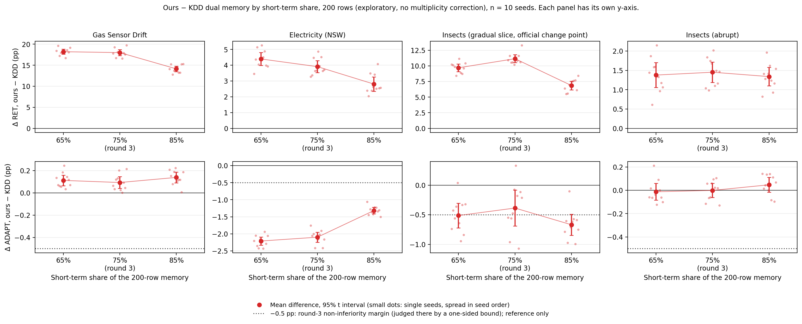
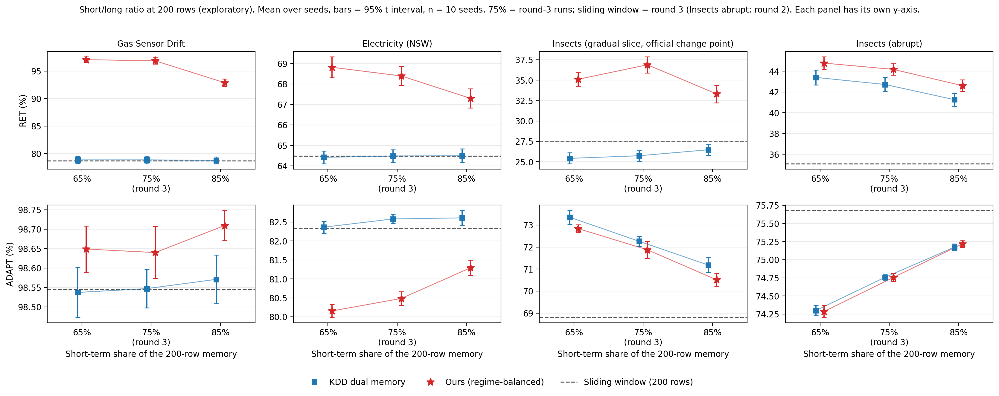

# Round 4：短期 / 长期占比（0.65 / 0.75 / 0.85，200 行，探索性补充）

预注册见 [phase56_prereg.md](phase56_prereg.md) 末尾的 "Exploratory short/long ratio analysis"。本文件是第三轮结果文件 [phase56_round3.md](phase56_round3.md) 的补充，报告结果，格式同第三轮但更短。**这是探索性分析：只描述，不检验，不设门槛，不做多重比较校正；第三轮的结论不被它改变。**

**一句话结论：** 在 4 条流（Insects 突变、Gas Sensor、Electricity、Insects 渐变切片）上，把 200 行记忆的短期占比从第三轮的 0.75 换成 0.65 或 0.85，阶段均衡的双记忆（ours）的保留（RET）仍然高于 KDD 双记忆：12 个（流，占比）组合全部是 10/10 个 seed 为正（各自独立的 95 % 区间，没有做多重比较校正，只作描述）。但增益的大小随占比变化：长期池越小（占比 0.85，长期池 30 行），Gas（+18.21 / +18.00 → +14.14 pp）和 Electricity（+4.40 / +3.91 → +2.80 pp）的保留增益越小，渐变段在 0.85 也最小（+6.85 pp，对比 +9.69 / +11.15），Insects 突变几乎不变（+1.38 / +1.45 / +1.34 pp）。Electricity 上 ours 的适应（ADAPT）代价也随长期池变小而变小（相对 KDD −2.21 / −2.10 → −1.32 pp），但三个占比都是 0/10 个 seed 为正，也都比 −0.5 pp 差：换一个占比不能两头都占。渐变段上 ours 的 ADAPT 也略低于 KDD（−0.51 / −0.39 / −0.67 pp），在 0.85 最差（0/10 个 seed 为正），所以在渐变段上，把短期占比提高到 0.85 让保留增益和适应两个指标都变差。**只在 200 行上做；探索性；占比只有三个点，相邻占比之间的很多差值小于 seed 间的波动，所以只能说"方向"，不能说"趋势显著"。**

## 1. 为什么做，做了什么

第三轮在 200 行时，Electricity 上 ours 相对 KDD 的 ADAPT 代价是 −2.10 pp（没过 −0.5 pp 边界），而且 ours 与 KDD 的短期 / 长期划分都固定在 0.75 / 0.25（KDD 论文调参网格的中间值 0.75，第二、三轮一直沿用；论文没有说主结果用的是哪个占比，预注册里已提交的措辞不改）。看过第三轮结果之后，我们想知道两件事：(1) 这个代价能不能靠换一个占比减小；(2) 阶段均衡的保留增益是否依赖 75 / 25 这个特定划分。所以这是**看过第三轮结果之后**才决定的分析（预注册补充说明写在这些运行之前）。

- **占比：** 0.65（短期 130 行 / 长期 70 行）和 0.85（170 / 30）。它们是 KDD 论文网格里的另外两个值，不是看过数据后挑的；但 KDD 论文只在总记忆 600 / 800 / 1000 行上、只看在线准确率搜过这个网格，200 行不在它的搜索范围内。
- **0.75（150 / 50）** 就是第三轮的 `dual200` / `dual200_rb`，没有重跑。同规模滑窗 `sw200` 也取自第三轮（Insects 的 `sw200` 取自第二轮）。
- **新跑的：** `dual200_s65`、`dual200_s85`、`dual200_rb_s65`、`dual200_rb_s85`，4 条流 × 10 个 seed = 160 个运行（GPU，TabPFN 6.4.1，`n_estimators = 4`，协议、流、留出集同第三轮）。渐变段的 ours 是 (a) 臂（在文档变点关闭 R0）。只做 200 行，没有做 1000 行。
- **校验：** 运行前先重跑 `electricity` / `dual200_rb` / seed 0（`calib4`），预测、检查点预测和摘要与第三轮同名运行逐位相同；这只证明那**一个**运行可复现，其余运行靠分析脚本逐 seed 核对：同一（数据流，seed）内所有方法的 y / 留出行 / 流下标 / 阶段边界 / 过渡区 / 记忆边界相同，上下文泄漏计数为 0，上下文不超过 200 行，并对 160 个第四轮运行做了标签重放，每个检查点的记忆摘要都与 npz 一致（0 个失败）。没有缺失的运行。
- 数字主要来自 `scripts/analyze_round4.py` 的自动报告 [round4_analysis.md](round4_analysis.md)（下文"报告 a 段"等指它的小节），逐 seed 数字在 [round4_per_seed.csv](round4_per_seed.csv)。例外有两处，由逐 seed CSV 另算、不在自动报告里：第 2.3 节 ours 与 `sw200` 的配对差，以及第 4 节第 6 点 KDD 自身 0.85 − 0.65 的配对差（含区间和正号 seed 数）。表里的数字另外用不依赖该脚本的独立程序重算过，全部一致（容差 0.01）。
- 准确率一律为平衡准确率，单位 %；差值单位 pp；± 是 10 个 seed 之间的样本标准差；差值是同 seed 配对，括号内是差值为正的 seed 数；区间是各自独立的双侧 95 % t 区间。

## 2. 主表

### 2.1 各占比的 ADAPT 和 RET（均值 ± SD，%；报告 a 段）

KDD = KDD 双记忆，ours = 阶段均衡双记忆；渐变段 ours 是 (a) 臂。`sw200` 是同规模滑窗，作参照。

| 数据流 | 占比（短 / 长） | ADAPT KDD | ADAPT ours | RET KDD | RET ours |
|---|---|---|---|---|---|
| gas | 0.65（130/70） | 98.54 ± 0.09 | 98.65 ± 0.08 | 78.84 ± 0.88 | **97.06 ± 0.74** |
| gas | 0.75（150/50） | 98.55 ± 0.07 | 98.64 ± 0.09 | 78.85 ± 0.97 | **96.85 ± 0.81** |
| gas | 0.85（170/30） | 98.57 ± 0.09 | 98.71 ± 0.05 | 78.74 ± 0.87 | **92.88 ± 0.92** |
| gas | sw200 | 98.54 ± 0.08 | | 78.67 ± 0.89 | |
| electricity | 0.65 | 82.37 ± 0.23 | 80.15 ± 0.24 | 64.42 ± 0.45 | **68.82 ± 0.72** |
| electricity | 0.75 | 82.58 ± 0.16 | 80.48 ± 0.25 | 64.48 ± 0.42 | **68.39 ± 0.66** |
| electricity | 0.85 | 82.61 ± 0.28 | 81.29 ± 0.28 | 64.49 ± 0.47 | **67.30 ± 0.65** |
| electricity | sw200 | 82.33 ± 0.17 | | 64.48 ± 0.48 | |
| insects_gradual | 0.65 | 73.35 ± 0.44 | 72.84 ± 0.25 | 25.42 ± 0.94 | **35.11 ± 1.15** |
| insects_gradual | 0.75 | 72.27 ± 0.33 | 71.88 ± 0.54 | 25.74 ± 0.89 | **36.89 ± 1.38** |
| insects_gradual | 0.85 | 71.18 ± 0.47 | 70.52 ± 0.43 | 26.48 ± 0.95 | **33.33 ± 1.51** |
| insects_gradual | sw200 | 68.80 ± 0.39 | | 27.52 ± 1.17 | |
| insects | 0.65 | 74.30 ± 0.10 | 74.29 ± 0.12 | 43.40 ± 1.00 | **44.78 ± 0.85** |
| insects | 0.75 | 74.76 ± 0.05 | 74.76 ± 0.08 | 42.72 ± 0.94 | **44.17 ± 0.76** |
| insects | 0.85 | 75.17 ± 0.06 | 75.22 ± 0.07 | 41.26 ± 0.87 | **42.60 ± 0.78** |
| insects | sw200 | 75.68 ± 0.07 | | 35.08 ± 0.58 | |

sw200 行的数字写在"ADAPT KDD"和"RET KDD"两列的位置，它不是 KDD 的数，是同规模滑窗的数（没有 ours 一栏）。0.75 行就是第三轮主表的 200 行（数字相同）。ADAPT (masked) 在报告 a 段，方向和 ADAPT 一致（例如 Electricity ΔADAPT masked −2.13 / −1.94 / −1.16）。

### 2.2 配对差 ours − KDD（同占比、同 seed；pp；报告 b 段）

单元格：均值 [95 % 区间]（正号 seed 数 / 10）。**不给 p 值。** −0.5 pp 是第三轮的非劣性边界，这里只作参照，本轮不设门槛，也不做检验。

| 数据流 | 占比 | ΔRET | ΔADAPT |
|---|---|---|---|
| gas | 0.65 | +18.21 [+17.61, +18.82]（10/10） | +0.11 [+0.06, +0.16]（10/10） |
| gas | 0.75 | +18.00 [+17.31, +18.69]（10/10） | +0.09 [+0.04, +0.14]（10/10） |
| gas | 0.85 | +14.14 [+13.47, +14.80]（10/10） | +0.14 [+0.09, +0.19]（10/10） |
| electricity | 0.65 | +4.40 [+3.99, +4.81]（10/10） | −2.21 [−2.33, −2.09]（0/10） |
| electricity | 0.75 | +3.91 [+3.53, +4.29]（10/10） | −2.10 [−2.25, −1.95]（0/10） |
| electricity | 0.85 | +2.80 [+2.35, +3.26]（10/10） | −1.32 [−1.41, −1.23]（0/10） |
| insects_gradual | 0.65 | +9.69 [+9.09, +10.29]（10/10） | −0.51 [−0.72, −0.30]（1/10） |
| insects_gradual | 0.75 | +11.15 [+10.51, +11.78]（10/10） | −0.39 [−0.69, −0.08]（1/10） |
| insects_gradual | 0.85 | +6.85 [+6.16, +7.54]（10/10） | −0.67 [−0.85, −0.49]（0/10） |
| insects | 0.65 | +1.38 [+1.06, +1.70]（10/10） | −0.01 [−0.08, +0.06]（3/10） |
| insects | 0.75 | +1.45 [+1.19, +1.71]（10/10） | −0.00 [−0.06, +0.06]（6/10） |
| insects | 0.85 | +1.34 [+1.10, +1.58]（10/10） | +0.05 [−0.02, +0.11]（8/10） |

0.75 行与第三轮第 2.1、2.3 节的配对差相同（Gas +18.00、Electricity +3.91、渐变段 +11.15、Insects +1.45；Electricity ΔADAPT −2.10）。

### 2.3 ours 相对同规模滑窗 `sw200`（同 seed 配对差，均值；pp）

这一节由逐 seed CSV 另算，不在自动报告里；与 `sw200` 的比较也不在预注册补充说明的"Reported"列表里，是额外的描述。

| 数据流 | ADAPT：0.65 / 0.75 / 0.85 | RET：0.65 / 0.75 / 0.85 |
|---|---|---|
| gas | +0.10 / +0.10 / +0.16 | +18.39 / +18.18 / +14.21 |
| electricity | −2.18 / −1.85 / −1.04 | +4.34 / +3.91 / +2.82 |
| insects_gradual | +4.04 / +3.08 / +1.71 | +7.59 / +9.37 / +5.81 |
| insects | −1.39 / −0.92 / −0.46 | +9.70 / +9.09 / +7.52 |

三个占比、四条流上，ours 的 RET 都高于滑窗；没有一个占比在两个指标上同时比滑窗差。Electricity 和 Insects 上 ADAPT 低于滑窗（随占比升高而缩小），Gas 和渐变段 ADAPT 不低于滑窗。

## 3. 图



**图 1（主图）** ours − KDD 双记忆的配对差，200 行；上排 ΔRET，下排 ΔADAPT；横轴是短期占比（65 % / 75 % / 85 %，其中 75 % 是第三轮的运行）。大点是 10 个 seed 的均值，竖线是双侧 95 % t 区间（不做多重比较校正），小点是单个 seed（水平位置按 seed 编号排开，不携带信息）。下排的点线是 −0.5 pp，即第三轮的 ADAPT 非劣性边界，**只作参照，本轮不做检验**；而且第三轮判定边界用的是**单侧**下界，这里的竖线是双侧区间，所以竖线碰到或越过这条线不等于第三轮意义上的"没过"（例如渐变段 0.75 双侧下端是 −0.69，第三轮单侧下界是 −0.63）。**两排、各列的纵轴刻度不同**，不能用线段的长短跨列比较。读法见第 4 节。



**图 2** 两种方法的绝对水平，200 行；上排 RET，下排 ADAPT；蓝色方块 = KDD 双记忆，红色星 = ours，灰色虚线 = 同规模滑窗 `sw200`（Insects 突变的滑窗来自第二轮，其余三条来自第三轮）；点是 10 个 seed 的均值，竖线是 95 % t 区间；75 % 的点是第三轮的运行。**每个子图的纵轴单独缩放**（例如 Gas 的 ADAPT 整个纵轴只跨约 0.3 pp，Electricity 的 ADAPT 整个纵轴跨约 3 pp），所以 Gas 上红星高出蓝方块一截，其实只有 0.1 pp 左右，不能与 Electricity 上约 2 pp 的差距按视觉高度比较。读法：上排四条流在三个占比上红星都在蓝方块之上，红星在 85 % 时最低；下排 Electricity 上 ours 随占比上升（80.15 → 81.29），但始终低于 KDD（82.37–82.61）和滑窗（82.33）；Gas 的所有点落在 98.54–98.71 之间。

两张图都是探索性描述，没有显著性标记。图由 `scripts/plot_round4.py` 生成。

## 4. 怎么读

1. **保留优势的方向不依赖 75 / 25 这个划分，大小依赖。** 在 0.65、0.75、0.85 三个占比、四条流上，ΔRET 都是 10/10 个 seed 为正，各自的区间都不含 0（第 2.2 节）；但大小会变：Gas 从 +18 降到 +14.14，渐变段从 +11.15 降到 +6.85（降了约 40 %）。这个"10/10"主要反映留出集抽样噪声：10 个 seed 共用大部分流，阶段均衡长期池里选到的行也几乎相同（第 5 节）。所以更稳妥的说法是"换占比后方向不变"，不是"有 12 个独立的显著结果"。
2. **长期池变小（0.85）时，保留增益在 Gas、Electricity、渐变段都变小；只有 Electricity 上适应代价同时变小。** Gas 和 Electricity 上 ΔRET 随短期占比升高单调下降（Gas +18.21 → +18.00 → +14.14；Electricity +4.40 → +3.91 → +2.80）；渐变段在 0.85 最小（+6.85），但 0.75 最高（+11.15），不单调。0.85 时长期池只有 30 行，阶段多的流上每个旧阶段只剩几行（Gas 流末每段 3–4 行，Electricity 每段 3 行，seed 0，报告 d 段），保留明显变差。相邻占比之间的差值多数小于或接近 seed 间的波动（例如 Electricity ΔRET 的 0.65 与 0.75 只差 0.49 pp），所以只有 0.75 到 0.85 的下降在 Gas、Electricity 上比较清楚。"长期池越大，保留越多，代价越大"这个读法只在 Electricity 上成立（ΔADAPT −2.21 / −2.10 / −1.32）。渐变段的规律相反：0.85 时保留增益最小（+6.85），适应代价也最大（ΔADAPT −0.67，0/10 个 seed 为正），长期池最大的 0.65 保留增益也不是最大（最大的是 0.75）；Gas 上没有适应代价（ΔADAPT 一直为正）；Insects 突变几乎不随占比变。
3. **Electricity 的适应代价能减小，但没有消失。** ΔADAPT −2.21 → −2.10 → −1.32，三个占比都是 0/10 个 seed 为正，都比 −0.5 pp 差得多。同时 ΔRET 也从 +4.40 降到 +2.80。所以在 Electricity 上，提高短期占比同时缩小了代价和保留增益：三个占比都没有让 ADAPT 代价回到 −0.5 pp 以内；代价最小的 0.85，保留增益也最小。一个可能的原因（解释，未做消融）：占比越高，ours 的记忆与"最近 200 行"重合得越多（Electricity ours 75.05 / 82.08 / 89.07 %，报告 e 段），越接近滑窗，而 Electricity 上旧数据本来就有害（第三轮第 3.5 节）。
4. **Insects 突变上几乎不随占比变化。** ΔRET +1.38 / +1.45 / +1.34，三个值只差 0.11 pp，而 ΔRET 的 seed 间 SD 约 0.4；ΔADAPT 在 0 附近（−0.01 / −0.00 / +0.05，区间都含 0）。Insects 上 ours 相对滑窗的 ADAPT 代价（−1.39 / −0.92 / −0.46）和 KDD 的几乎一样（KDD 相对滑窗 −1.38 / −0.92 / −0.51），都随占比升高而变小，两者几乎相同，说明这个代价主要与双记忆结构有关，而不是阶段均衡带来的（没有做消融）。
5. **Gas 和渐变段在 0.85 时优势明显变小。** Gas ΔRET 从 +18 降到 +14.14（ours 的 RET 从 97.06 / 96.85 降到 92.88，R0 从 95.84 / 95.42（0.65 / 0.75）降到 85.22，报告 c 段）；渐变段 ΔRET 从 +9.69 / +11.15 降到 +6.85，同时 ΔADAPT 最差（−0.67，区间 [−0.85, −0.49]，几乎全在 −0.5 线之下）。Gas 的 ΔADAPT 一直在 +0.09 到 +0.14 pp，已在上限附近，没有实际意义。
6. **KDD 自身随占比的变化因流而异。**
   - Gas、Electricity：ADAPT 和 RET 的变化都很小（最大 0.25 pp，Electricity 的 ADAPT）。
   - 两条 Insects 流：不小，而且两个指标反向变动。Insects 突变：占比越高 ADAPT 越好（74.30 → 75.17，+0.87 [+0.78, +0.97]，10/10）、RET 越差（43.40 → 41.26，−2.14 [−2.35, −1.92]，0/10）。渐变段相反：ADAPT 越差（73.35 → 71.18，−2.17 [−2.40, −1.94]，0/10）、RET 越好（25.42 → 26.48，+1.05 [+0.76, +1.35]，10/10）。这几个 0.85 − 0.65 的配对差由逐 seed CSV 另算，不在自动报告里。
   - 与 KDD 论文对照：论文报告，在总记忆 600 / 800 / 1000 行 × 短期占比 0.65 / 0.75 / 0.85 的网格上，在线准确率很稳定（标准差最多 0.31，RIALTO 除外）。在 200 行时，KDD 双记忆的 ADAPT 在 Gas 和 Electricity 上同样稳定（最大差 0.25 pp），在 Insects 突变（0.65 → 0.85 差 +0.87 pp）和渐变段（−2.17 pp）上变化更大。RET 是论文没有看的指标，不在它的说法范围内，只能单独描述。这**不是对那篇论文的反驳**：论文是总记忆 600–1000 行，这里是 200 行。（这里是转述，不是论文原话。）
7. **各阶段（报告 c 段）。** Electricity 的最后一个被评估阶段 R8，ours − KDD 在三个占比都是负的（−2.32 / −2.63 / −2.73，正号 1/10、0/10、0/10），Insects 的 R4 也是负的（−0.83 / −0.60 / −2.05）；这些阶段结束后只被测量很短一段时间，不能读成"ours 遗忘了最后一个阶段"（同第三轮第 3.3 节）。0.85 时 Electricity 的增益分布也变了：R0–R3 缩小，R4–R6 反而变大（0.65 → 0.75 → 0.85：R2 +11.29 → +9.73 → +4.85；R6 +2.48 → +3.02 → +4.64）。

## 5. 局限

- **探索性。** 这个分析是看过第三轮结果之后决定的（起因是 Electricity 的适应代价和 75 / 25 划分是否关键）。不做多重比较校正，不设门槛；区间是各自独立的 95 % 区间，数量很多（4 条流 × 3 个占比 × 2 个指标），偶然的"全部为正"不能当证据。
- **只在 200 行。** 1000 行没有跑（GPU 时间）。第三轮里 Electricity 在 1000 行时的代价小得多（−0.51 pp），但也没过 −0.5 pp 边界，所以这里的占比效应不能推到 1000 行。
- **占比只有三个点。** 单调与否只由 3 个点判断，相邻占比之间的很多差值小于 seed 间 SD，只能说方向，不能说趋势显著。
- **seed 不是独立的流。** seed 只改变留出集的抽样和 TabPFN 的随机性，流（去掉各自的留出行之后）在 seed 之间大部分相同，阶段均衡长期池里选到的行也几乎相同，所以"正号 seed 数"主要反映留出集抽样噪声，区间偏窄。
- **继承第三轮的局限：** ours 用了官方阶段边界，RET 对评估阶段等权平均，这个指标本身对 ours 有利；只有 4 条流；Electricity 的标签定义特殊，结论只适用于每批 50 行的设置。
- **0.75 列来自第三轮（代码版本不同）。** `calib4` 只在 electricity / `dual200_rb` / seed 0 一个运行上逐位复现了第三轮，其余靠上面第 1 节的逐项核对。
- **运行前的检查。** 预注册补充说明提交之后、正式运行之前，对运行包做过截断的流程自测（CPU，单个 ensemble 成员，前 3,000 行，seed 0–1）；它们不属于报告的结果。
- **机制解释未做消融。** 第 4 节第 3 点（记忆越接近滑窗，代价越小）只是与重合度数据相容的解释，没有检验。

## 6. 复现

```bash
bash scripts/reproduce_round4.sh   # 全部运行（GPU），然后生成报告、逐 seed CSV 与图；需要先有第三轮（results/round3）与第二轮（results/round2）的结果
# 只重新汇总已有结果：
python scripts/analyze_round4.py   # 默认读 results/round4、results/round3、results/round2，npz 在别处时加 --dir、--round3_dir、--round2_dir
python scripts/plot_round4.py
```

原始 npz 文件没有放进仓库；逐 seed 的指标在 [round4_per_seed.csv](round4_per_seed.csv)，完整的自动报告是 [round4_analysis.md](round4_analysis.md)。
